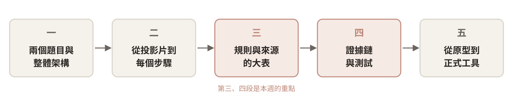
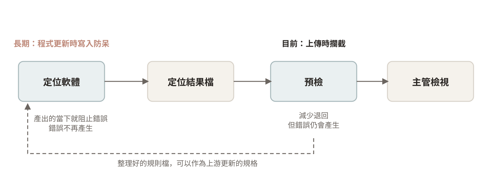
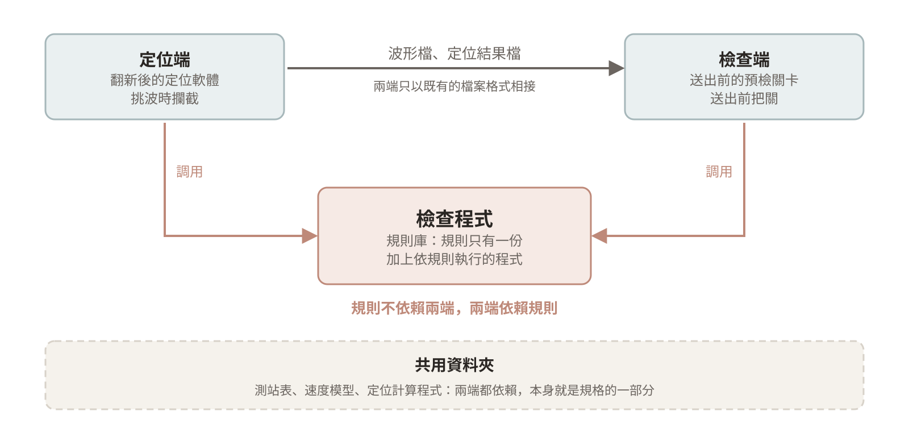
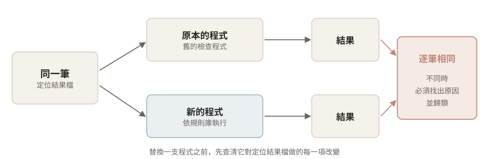
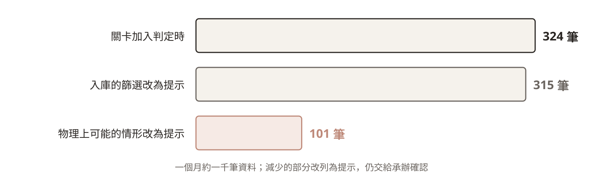
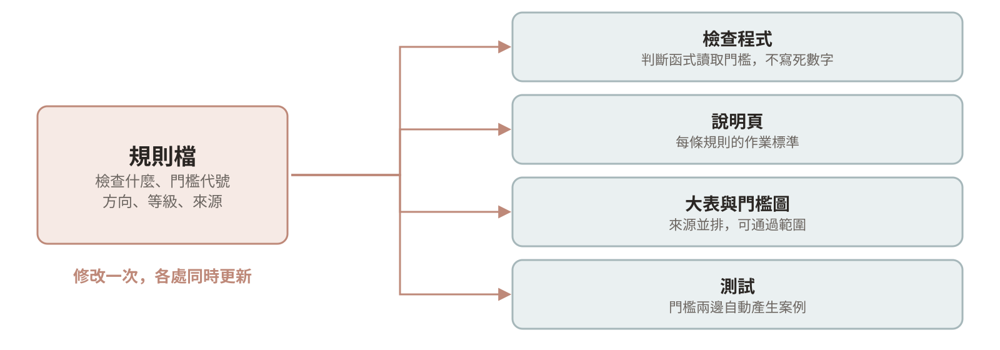
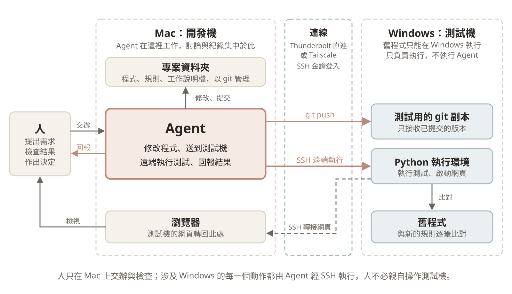
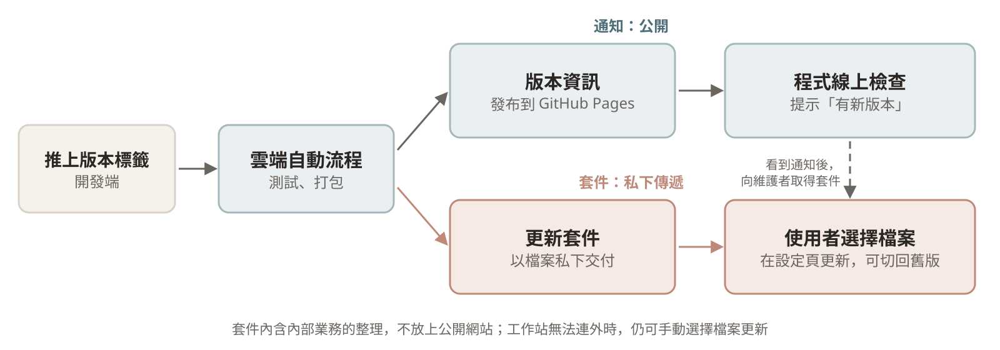

## 從原型到有依據的規則

第六週以一個預檢工具為例，走完需求階段。開發者以 vibe coding 做出原型，確認了畫面與操作，範圍畫在「自己用的小工具」為止。

這段期間，開發者從業務單位接到兩個需要解決的題目，各附一份程式包：一是送出前的預檢，附上檢查用的舊程式；二是翻新老舊的定位軟體，附上它的安裝包。

本週接續同一個案例，說明原型背後的檢查規則如何整理出來。原型要交給同仁使用、取代原本的流程，每一條規則就必須說得出出自哪裡、為什麼要檢查，以及為什麼某些檢查沒有收錄。本週的主體就是這段整理的過程，以及最後形成的一張規則與來源的大表。

以下分五個部分：先說明兩個題目的整體架構，再從訓練投影片查清每個步驟實際做了什麼，接著整理成規則與來源的大表，然後說明如何以證據鏈與測試確認大表可信，最後說明原型如何成為同仁可以安裝與使用的正式工具。每一部分以幾個設計重點串起，案例的細節作為證據。結語整理 AI 在各個環節的角色。

原型實際上沒有丟棄。程式還改得動，開發者就在原型上繼續修改，每改一步都以回歸基準確認結果與修改前相同，不一次重寫。是否重寫留到上線對接之前，屆時依對方現有的技術框架與執行環境再做評估。

## 本週的設計重點

| 部分 | 設計重點 |
|---|---|
| 一 | 要補齊漏洞，定位與檢查必須一起考慮 |
| 一 | 規則只有一份，兩端依賴規則，彼此以檔案相接 |
| 二 | 清單以承辦熟悉的投影片為骨架 |
| 二 | 要分階段替換，先保持行為一致 |
| 二 | 查到程式的層次，以實際行為為準 |
| 三 | 每一條規則都要能回溯到原文 |
| 三 | Agent 負責列舉，人負責決定 |
| 三 | 依檢查的對象分類，欄位寫出設計意圖 |
| 三 | 從不同角度檢視把關的嚴謹程度 |
| 三 | 去留依固定的原則決定 |
| 四 | 從原文到結果，每一個環節都要能檢查 |
| 四 | 規則只寫在一處，各處由它產生 |
| 四 | 新舊結果要一致，差異一律歸類 |
| 四 | 以測試守住證據鏈，失敗時看得出原因 |
| 五 | 執行環境要能重現 |
| 五 | 每一筆處理都留下紀錄 |
| 五 | 能夠安裝，也能退回 |
| 五 | 只公開可以公開的內容 |
| 結語 | 結果要穩定的節點用程式，AI 用在開發端 |
| 結語 | 交給 AI 的工作，要一併準備查證的方式 |

## 一、兩個題目與整體架構

### 要補齊漏洞，定位與檢查必須一起考慮

只在送出前檢查，可以減少退回，卻無法讓錯誤不再產生。錯誤是在定位時產生的，要讓它不再發生，就必須在定位的當下攔下，因此預檢與定位軟體的翻新要視為同一個整體的兩個部分。

#### 錯誤從定位流到檢查

承辦以定位軟體讀取波形檔，在波形上挑選各測站的到時，交給定位計算程式定出地震，存出定位結果檔。接下來就是檢查，確認結果沒有問題之後，資料才進入資料庫。

第六週提到，問題之所以留到送出前的檢查才被發現，根本原因在於上游的定位軟體沒有防呆。定位軟體的流程設計本身不會阻擋這些問題：近站沒有挑選、殘差過大、改了挑波卻沒有重新定位，都能照常存出定位結果檔。原本的檢查程式也不在必經的路徑上，要有人自行點選執行才會檢查，沒有人執行，錯誤就一路流到檢查端，再退回挑波修正。

#### 兩份程式包共用的資料夾

兩個部分在資料上也連在一起。比對兩份程式包之後發現，檢查用的舊程式與定位軟體都依賴同一個核心的共用資料夾，因此先分析這個資料夾。資料夾中有三百多個檔案，定位與檢查所需的資料與程式大多集中在這裡，可以分成以下幾類：

| 類別 | 重要的內容 |
|---|---|
| 定位計算程式 | 三代程式：早期的互動版、Windows 命令列版，以及三維定位程式，附部分原始碼 |
| 測站表 | 兩個世代：舊表約在 2010 年底停止維護，現行表持續維護 |
| 速度模型 | 一維與三維的速度模型 |
| 規模與強震 | 規模計算、場址係數與強震預測 |
| 波形與格式轉換 | 波形的解讀、格式轉換與訊號處理 |
| 地圖與繪圖 | 行政區界、海岸、斷層、地形與繪圖指令稿 |
| 其他 | 參考目錄、範例檔、資料庫、函式庫、影像與字型 |

測站表、速度模型與定位計算程式決定了定位的結果，也是檢查規則的依據。翻新定位軟體或重寫檢查時，這些檔案都要沿用或對照，因此共用資料夾本身就是規格的一部分。

### 規則只有一份，兩端依賴規則，彼此以檔案相接

兩個部分在流程與資料上都要一起考慮，程式卻要各自獨立運作。規則若在兩端各寫一份，遲早會不一致；兩端的程式若互相呼叫，任何一端翻新都會牽動另一端。因此規則抽出來自成一塊，兩端都依賴它，兩端之間只以既有的檔案格式相接。

#### 三個區塊與依賴的方向

整個系統分成三個區塊：

1. **檢查程式**：規則庫，加上依規則執行檢查的程式。
2. **定位端**：翻新後的定位軟體，在挑波時調用檢查程式，提早發現問題。
3. **檢查端**：送出前的預檢關卡，調用同一個檢查程式。

依賴的方向是單向的。規則不依賴定位端與檢查端，定位端與檢查端依賴規則，所以規則只需要一份，兩端的完成條件自然一致。在定位軟體裡補上防呆，也需要一份明確的規則作為依據。這份規則同時供兩端使用：預檢先用它在送出前把關，定位軟體翻新時再用它在挑波時攔截。兩端之間只靠波形檔與定位結果檔等檔案傳遞資訊，這些格式本來就是現行流程的介面，舊的定位軟體存出的檔案，新的檢查程式也能直接檢查。

目前專案規模還小，檢查程式先與檢查端的網頁放在同一個專案裡打包。在邏輯上它是獨立的一塊，之後會獨立成自己的專案，有自己的版本與設定，第五部分再說明。

規則既然要供兩端共用，就必須先整理清楚。整理從承辦最熟悉的訓練投影片開始。

## 二、從投影片到每個步驟的實際行為

這一部分先以訓練投影片列出流程的步驟，再查清每個步驟背後的程式實際對資料做了什麼。

### 清單以承辦熟悉的投影片為骨架

投影片寫的是承辦實際操作的流程，因此檢查清單照投影片原有的步驟編號與順序排列，不另訂新的流程。每一項檢查都能對回投影片的頁碼，承辦看到的仍是熟悉的步驟，只是改由程式先行執行。之後調查找到的操作，也掛回最相關的步驟下。

#### 投影片的三大步

| 投影片的步驟 | 原本的內容 | 預檢的處理 |
|---|---|---|
| 第一步 | 檢視波形，確認沒有地震的波形檔並刪除 | 讀取波形檔判斷有無訊號，只把不確定的檔案交給承辦確認 |
| 第二步 | 執行舊的檢查程式產生錯誤清單，逐項判讀；把事件依時間排序，逐筆檢視時間相近、相位數、定位誤差與規模；修正後重複檢查 | 自動執行並分類，修正後自動重跑整串檢查 |
| 第三步 | 篩選範圍、測站數與相位數，比對時間相近的事件，入庫、備份與回報 | 篩選先行標示，入庫、備份與回報不變 |

預檢負責的是第一步的後半與整個第二步，也就是原本在送出之後才做的檢查，提前到送出之前執行。第三步的入庫屬於入庫管理，仍維持原本的做法。

投影片因此提供了清單的骨架。但投影片只寫出承辦要做的步驟，每個步驟背後由哪些程式執行、程式又對資料做了什麼，投影片並沒有寫。

### 要分階段替換，先保持行為一致

原本的程式要分階段替換。每換掉一支程式，新的程式都必須先與原本的行為一致，否則同一筆資料經過新舊流程會得到不同的結果，也說不出差異從哪裡來。因此在替換之前，要先寫清楚每個步驟實際對定位結果檔做了什麼：讀取哪些欄位、依什麼條件判斷、門檻是多少、結果如何處理。

### 查到程式的層次，以實際行為為準

每個步驟實際做的事，多半不在投影片上，而在投影片提到的程式，以及它們依賴的共用資料夾裡。文件與程式並不總是一致，因此要讀到程式的層次，並以實際執行的結果為準。

#### 回到原始碼，或實際執行

開發者以 Agent 調查這些程式，可以追溯到文件以外的行為。有原始碼的程式，Agent 逐支讀取原始碼，再與說明文件和程式的介面對照，看實際發生了什麼。只有執行檔的程式，Agent 解析執行檔內含的資訊，再在測試機上實際執行，觀察它的行為。

這樣調查出來的，多半是文件沒有寫、卻會影響定位與檢查結果的細節，例如模型的選用方式、測站表如何決定哪些資料留下、程式依賴的執行環境。逐檔對照原始碼、還要實際執行驗證，所需的人力很大，沒有 Agent 時很難在短時間內完成。

#### 一個步驟做的事不只是檢查

調查的結果顯示，一個步驟做的事不只是「檢查並報錯」。開發者把每個來源做的事分成六種：

| 種類 | 說明 | 例子 |
|---|---|---|
| 檢查 | 判斷是否有問題並報錯 | 殘差超過門檻 |
| 修正 | 直接改寫檔案 | 欄位溢位印成星號時，改為 0 |
| 篩選 | 決定是否入庫或輸出 | 震央超出監測範圍的事件不入庫 |
| 重跑 | 決定是否重新定位 | 定位誤差大於 2 公里時改用一維模型重跑 |
| 分流 | 決定資料的去向 | 有感的遠震放入目錄，並另行詢問是否入庫 |
| 步驟 | 作業程序本身 | 備份、回報 |

只看投影片，通常只會看到檢查。修正與篩選卻同樣會改變最後進入資料庫的資料，而且常常不留紀錄。

#### 隱藏在程式裡的篩選

這類操作最容易遺漏，以下是整理過程中找到的例子：

- **入庫程式有內建的預設範圍。** 即使不下任何參數，規模、深度或方位角空缺超出預設範圍的事件也會被淘汰，負深度的事件在內。
- **月底的轉檔程式會靜默略過部分事件。** 沒有測站規模的事件直接跳過，不留任何紀錄，流程文件也沒有提到。
- **文件與程式的門檻不同。** 說明寫「超過 200」，程式為「達到 200」；說明寫預設值 1，程式實際為 0。
- **執行檔與原始碼不同。** 某一年的執行檔含有原始碼沒有的參數，實際行為不能只看原始碼。

#### 調查結果掛回投影片的步驟

調查找到的操作，凡是投影片沒有寫到的，都掛在最相關的步驟下方，並註明來源。清單因此仍維持投影片的結構，承辦看到的是熟悉的步驟，每一項補充也看得出它補在流程的哪個位置。這是承辦看到的清單；整理規則的大表則改依檢查的對象分類，原因在第三部分說明。

#### 補充：只有執行檔時，以逆向工程工具協助

只有執行檔的程式，除了實際執行、觀察行為之外，還可以借助逆向工程的工具。近期受到關注的開源專案 Reverse Engineer Anything（REA），把反組譯與逆向工程的工具（例如 Ghidra、IDA）接上 Claude Code、Codex 等 Agent。開發者尚未實際試用。專案本身沒有列出固定的步驟，以下依專案說明與報導整理它的流程：

1. **提供工具。** 以 MCP 把反組譯工具交給 Agent 使用，分析在本機進行。
2. **檢視程式。** Agent 查詢反組譯的結果，檢視函式與彼此的呼叫關係。
3. **追蹤行為。** 從想了解的功能出發，追蹤相關的程式碼，並附上證據。
4. **驗證假設。** 反覆提出對程式行為的假設，回到執行檔上驗證。
5. **重建行為。** 依調查結果寫出行為相同的程式，並以測試與原程式比對。專案的展示中，重建的函式通過了與原程式比對的全部 3,205 個案例。

它重建的是程式的行為，不是原始碼。這個流程與本案例對舊程式的做法相同：先看程式實際做了什麼，再以逐筆比對確認一致，差別只在於能從執行檔內部追蹤，而不只觀察輸入與輸出。依專案說明，Ghidra 也能分析 16 位元的 DOS 程式。使用這類工具之前，要先確認取得分析的授權。

來源：Renato Losio，〈Reverse Engineer Anything Project Brings AI Agents to Binary Analysis〉，InfoQ，2026-10-17，<https://www.infoq.com/news/2026/10/reverse-engineer-anything/>；專案頁 <https://github.com/morluto/rea>（MIT 授權）。查閱日期 2026-10-19。

## 三、規則與來源的大表

整理的結果是一張規則與來源的大表。這一部分以五個設計重點說明大表如何建立、規則如何分類，以及為什麼有這些去留，這些設計意圖都可以從大表的欄位看出來。

### 每一條規則都要能回溯到原文

規則要交給同仁使用、在會議上討論，被問到「這條規則從哪裡來」時，必須能直接指出原文。因此開發者先不寫規則，而是先列出每個來源實際做了什麼，再要求條目與規則兩個方向都有交代，最後讓每一格都能點開原文。

#### 逐項列出來源做了什麼

開發者逐一閱讀每個來源，列出它實際做的每一件事。來源包括舊的檢查程式、定位計算程式、入庫程式、訓練投影片、流程文件、操作說明與紙本清單。每一個條目記錄以下內容：原文的位置（原始碼的檔名與行號，或文件的頁碼）、種類、條件、門檻與輸出，以及與其他來源不一致的地方。

擷取時有幾條固定的原則：一個判斷條件一個條目，以原始碼的實際邏輯為準、不推測，說明文件與原始碼不一致時兩者都寫。每個來源也記錄作者與年代，日後對規則原意有疑問時，知道該向誰確認。

目前共有 18 個來源、672 個條目。條目的數量遠多於規則，因為其中大部分是作業步驟、修正或其他功能，並不是送出前的檢查。閱讀與列舉的工作主要由 Agent 進行，見下一個重點。

#### 雙向溯源

條目與規則之間，要求兩個方向都有交代：

- 每一個來源條目，必須被某條規則接住、註明不納入的理由，或列為待決定，三者擇一。
- 每一條規則，必須有至少一個來源，或註明沒有現行依據。

程式會自動檢查這兩個方向，有任何一項沒有交代就報錯。新增規則或修改來源時，不必靠人記得對照。

#### 可以點進去看來源的介面

Agent 一次產出數百個條目，人無法逐項相信，也無法逐項重讀原文。重掃報告的結論，也只有一部分回到原文核對過。整理規則的過程需要反覆查閱與驗證，因此另外做了一個查看來源的介面：

- **大表的每一格都能點開原文。** 原始碼直接捲到對應的行號區間，並以語法上色；投影片與文件開到那一頁；紙本清單開啟照片。
- **原文旁邊列出 Agent 的整理。** 條件、門檻、輸出與對應的規則並列在原文旁，方便逐項對照。

這個介面把查證的成本降到點一下。開會討論規則時，也能直接開啟原文，不必憑記憶爭論文件怎麼寫。介面本身同樣是以 Agent 開發的。

### Agent 負責列舉，人負責決定

逐項閱讀數百個條目，工作量大而且可以平行進行，適合交給 Agent；哪些要收錄、門檻取哪一個數值，則是業務上的決定，留給人。這一點延續第五週的「不自行裁定」：Agent 可以把不一致的地方全部找出來，但選定哪一個數值，是業務上的決定。

#### 以大量 Agent 平行閱讀

第二部分的調查，是為了弄清楚程式實際的行為；建立大表時，則要把每個來源的判斷條件逐條列出，數量多出許多。這是本案例使用 Agent 最多的地方。

- **第一輪。** 由 4 個 sub-agent 分別閱讀不同的程式與文件，同時進行。主責的 Agent 訂定格式、整合比對，並把每一個條目對應到規則。第一輪共 13 個來源、約 340 個條目。
- **第二輪重掃。** 第一輪依意圖分組，可能漏掉條件，也可能把多個條件放進同一個條目。因此每個來源再交給一個 Agent 重讀，先不看既有的整理，照「一個判斷條件一行」列出原文的全部條件，再與既有條目比對。另外由一個 Agent 檢查還沒有收錄的檔案。重掃之後，來源增為 18 個，條目增為 672 個，待決定由 4 項增為 51 項，處理之後剩 34 項。

重掃也找出第一輪的錯誤。例如某支舊程式的參數，第一輪的描述與原文剛好相反；某個欄位的位置，第一輪記錯了一欄。這些錯誤都是回到原文核對才確認的。

#### 人負責的部分

- 擷取的格式與比對的標準，由開發者訂定。
- 不納入的理由與待決定的項目，由開發者決定。待決定的項目先以一個月的真實資料算出會攔到幾筆，再交給人判斷，Agent 不自行新增規則。
- 不同來源之間不一致的數值，整理成會議議題，交由檢查端的同仁決定。

### 依檢查的對象分類，欄位寫出設計意圖

同一件事常分散在好幾個來源與步驟裡，依來源或步驟分類，同一條規則會散在好幾處。依定位結果檔上被檢查的對象分類，同一件事只會出現在一列，不同來源的說法並排在同一列上。大表的每一個欄位也都對應一個設計意圖，讀表的人不必另看說明。

#### 規則的分類

規則依被檢查的對象分成 9 個項目：檔案格式、發震時間、震央位置、震源深度、規模、挑波、測站與資料量、定位品質、事件與入庫。例如定位誤差大於 2 公里，同時出現在訓練投影片與流程文件中，在大表上只占一列。

偵測與處理也分開。大表的主體是檢查，「該不該重跑」與「入庫怎麼分流」另外列成兩組規則，只寫觸發的條件與去向。規則的名稱以檢查的欄位與判斷命名，不寫門檻數值，門檻改變時名稱不必跟著修改。一條規則也只檢查一件事、只有一個等級：例如原本「深度為 0 或過淺」放在同一條，分兩級處理，但深度為 0 代表沒有計算或經人工修改，屬於流程錯誤，深度大於 0 而很小則是計算過的結果，要確認是否合理，兩者意義不同，因此拆成兩條，一條擋下、一條提示。

#### 大表的欄位與設計意圖

大表的每一列是一條規則，每一欄是一個來源。欄位如下：

| 欄位 | 內容 | 設計意圖 |
|---|---|---|
| 項目、規則、名稱 | 9 個項目、規則編號，以欄位與判斷命名 | 依檢查的對象分類，門檻不進名稱 |
| 目的 | 為什麼要檢查；待決定的列，寫出要確認的問題 | 每條規則都要說得出理由，說不出理由的就列入討論 |
| 檢查的欄位 | 讀取定位結果檔的哪些欄位 | 讓承辦知道去哪裡修正，也讓網頁能在原文上標出位置 |
| 建議處置 | 自動修正、重跑或人工處理的具體做法 | 檢查結果要能轉成動作；沒有具體做法的留空，不勉強填寫 |
| 狀態 | 待確認、候選、不啟用，或待決定的三種類別 | 記錄每一條規則的去留進行到哪一步 |
| 程式 | 檢查中、未執行 | 區分規則庫裡有的與程式實際在執行的 |
| 各來源欄 | 依年代由舊到新排列，分為現行與參考，並標出主要依據 | 同一條規則在不同年代的門檻是否一致，橫向比對即可看出 |
| 格子 | 來源條目的編號與門檻，可以點開原文 | 每一格都能回到原文查證 |

大表之外另有一張來源表，列出每個來源被接住、不納入與待決定的條目數。有兩支排序與合併的舊程式，條目全部不納入，因此大表不列它們的欄位。

### 從不同角度檢視把關的嚴謹程度

同一套規則，依年代看，可以看出門檻是否隨時間改變；依流程看，可以看出資料經過的每一道關卡各自檢查了什麼、哪一道收得最窄。不同的問題需要不同的看法，因此大表提供多種排列與圖，而不只一張表。

#### 依流程排列

來源欄改依資料實際經過的流程排列，不在現行流程中的來源先行隱藏，並設為預設的顯示方式。只靠人工檢查、沒有程式把關的地方另外標色，原本依年代標出主要依據的顏色，則留在依年代的看法中。資料一路經過好幾道關卡，有些步驟會重複檢查同一件事，依流程排列之後，可以看出每一道關卡各自檢查了什麼。

#### 門檻圖

點選大表的一列，下方開啟這條規則的門檻圖。以方位角空缺為例，每個來源各有自己的門檻，門檻圖把每一步的可通過範圍畫在同一條數線上，哪一步收得最窄，一眼就能看出來。界線含等號與不含等號以實線和虛線區分；檔名這類文字的規則不畫數線，改列出它排除的內容與例子；只修正、不攔下的靜默處理也畫上去，但以淡色表示，不算一道關卡。

門檻圖上每一條界線都對應到一組例子：越過界線、應該攔下的資料，以及剛好在界線內、應該通過的資料。這些例子後來直接成為第四部分的測試。

另有一頁依流程估算一個月的資料在哪一道關卡第一次被攔下，看的是某個月的實際成效；門檻圖看的則是規則本身的寬鬆程度，兩者分開呈現。

### 去留依固定的原則決定

去留若逐條憑感覺決定，前後就會不一致，也說不出理由。因此先訂出原則，每一條的去留都對應到其中一項，大表的狀態欄記錄每一條走到哪一步。

#### 去留的原則

- **不納入的條目。** 作業步驟、入庫後的作業、工具的其他功能選項、介面操作與改寫原檔的功能，不屬於送出前的檢查，註明理由後不納入。
- **入庫的篩選屬於入庫管理。** 入庫程式本身的篩選（預設範圍、抽取的上限、欄位處理等）共 15 項，改為不納入。震央超出監測範圍、測站數不足等情形，改由入庫分流標示去向，不在預檢擋下。
- **物理上可能發生的情形改為提示。** 規模為負、深度為負、殘差過大、近站未挑選、疑似重複事件、定位誤差過大，這些情形有可能是資料本來的樣子。直接擋下等於認定挑波或定位沒有做完，因此改為提示，由人確認。
- **待決定的條目交由會議決定。** 待決定分為三類：確認作法、新增規則、門檻不一致。不同來源的數值不一致時，例如重複事件的時間差有三種說法，開發端不自行裁定，而是整理成開會議題。
- **沒有來源的候選規則刪除。** 有幾條候選規則最早是 Agent 在構想階段提出的，從來沒有經過確認，也找不到現行的依據。第 12 版把它們全部刪除，規則庫中因此不再有沒有來源的規則。

#### 去留之後的數量

以一個月約一千筆資料為例，關卡剛加入判定時，不通過的事件有 324 筆。入庫的篩選改為提示之後減為 315 筆，物理上可能發生的情形改為提示之後再減為 101 筆。

{width=85%}

目前大表共 76 列，其中 43 條規則（36 條由程式執行），以及 33 列待決定，另有重跑與入庫分流兩組。所有規則都還是待確認的狀態，要由檢查端的同仁逐條確認。

## 四、證據鏈與測試

大表整理出來之後，接著要回答的是：大表是否可信，日後修改時又如何確保它不被破壞。

### 從原文到結果，每一個環節都要能檢查

一條規則要讓人相信，必須能從檢查結果一路追回原文。這條鏈只要有一個環節無法檢查，整條鏈就不可信，因此每一個環節都要有檢查的方式。

#### 證據鏈的四個環節

| 環節 | 要回答的問題 | 檢查的方式 |
|---|---|---|
| 原文 → 來源條目 | 來源實際做了什麼，有沒有讀錯 | 每個條目記錄原文位置，可以點開原文對照；整份來源由 Agent 重讀一次 |
| 來源條目 → 規則 | 每一項是否都有交代 | 雙向溯源，由程式自動檢查 |
| 規則 → 程式 | 規則庫寫的是否就是程式在執行的 | 規則與判斷分離，說明頁由規則檔產生 |
| 程式 → 結果 | 新程式的結果是否與原本的流程一致 | 在測試機上以舊程式執行同一批資料，逐筆比對 |

前兩個環節已在第三部分說明：逐項列出來源做了什麼並以 Agent 重讀、點開原文核對，再以雙向溯源對應到規則。以下說明後兩個環節，以及如何以測試守住整條鏈。

#### 證據鏈的價值

四個環節都可以檢查之後，任何一條規則被質疑時，都能回答三個問題：它出自哪一個來源的哪一行或哪一頁，為什麼要檢查，與舊程式的結果是否一致。不同年代的門檻不一致時，也能直接在大表上看出來，帶到會議上討論。

### 規則只寫在一處，各處由它產生

同一條規則若在程式、說明頁與大表各寫一次，修改時總會漏掉一處。因此規則只寫在規則檔，程式、說明與測試都從這裡讀取。

#### 規則與程式分開

規則檔只寫檢查什麼與門檻，判斷的程式不寫死任何數字，每一條規則指向一個判斷函式，門檻由規則檔傳入。整個規則集有版本號，每一份檢查結果都註明依第幾版規則檢查。

這樣分開之後，修改門檻不必修改程式，檢查端的同仁也能直接讀懂每一條規則。網頁上的說明頁、大表與閱讀版的規格都由同一份規則檔產生，修改一次，各處同時更新，說明與實際的檢查不會不一致。

門檻的方向與等級也寫進規則檔，作為規格。程式、大表上的門檻圖與測試都從這裡讀取，測試因此可以由規則檔自動產生：每個門檻各產生一筆剛好越過與一筆剛好在界線內的資料，「大於」誤寫成「大於或等於」這類錯誤會直接失敗。另有一項檢查，確認每一條規則都有攔下與通過的測試，新增規則時不會漏寫。

門檻以代號登錄，規則的設定頁列出每個門檻目前的數值、使用它的規則，以及這個數值是已經訂定或暫時沿用。尚待開會確認的門檻因此一目了然，定案之後只改一處。

### 新舊結果要一致，差異一律歸類

最後一環要證明，新程式的結果與原本的流程一致：原本查得到的問題，新程式都查得到；兩者不一致的地方，每一筆都找得到原因。只說「大致相同」，無法交給同仁取代原本的流程。

#### 與原本的流程逐筆比對

- **以舊程式執行真實資料。** 在 Windows 測試機上，以舊的檢查程式執行一個月 1,049 個檔案，與新程式逐筆比對。除了一條算法刻意不同的規則之外，舊程式攔下的檔案，新程式都攔下了。
- **人工製造的錯誤檔。** 真實資料不一定涵蓋每一種錯誤，因此從一個正確的虛構檔案出發，每次只改一個地方，例如 24 時、60 秒、殘差恰為門檻與略高於門檻，共製作 74 個案例。新舊程式各執行一次，確認兩邊都抓到，而且在門檻上的判斷一致。
- **門檻兩邊的例子也以舊程式實測。** 每個門檻兩邊的例子，除了交給新程式執行，也在測試機上以舊程式執行。這樣區分兩件事：重建的規則是否正常運作，以及原本的程式實際測出來的結果，是否符合開發端對門檻的理解。兩項測試都通過的例子，在規則的說明頁上打勾，並可以展開實際的檔案內容。
- **差異一律歸類。** 每一筆不一致都要歸入四類之一：新規則刻意不同、舊程式的錯誤、新程式的錯誤、門檻尚未定案，不停在「有差異」。例如有一筆差異，查明是舊程式只比對整數秒、沒有進位造成的。

逐筆比對也抓到了新程式的錯誤。以另一支舊程式執行錯誤檔時，查出一條規則少算了一行，原因是 Agent 讀錯了原始碼。修正之後，規則集升了一版。

### 以測試守住證據鏈，失敗時看得出原因

證據鏈建立之後，還要確保日後的修改不會破壞它。程式與規則都由 Agent 協助修改，修改的次數多，不能靠人記得每次重新核對，因此把前面的查證寫成自動執行的測試。測試失敗時，也要一看就知道問題出在哪裡。

#### 測試的設計

- **依失敗的意思分層。** 測試依「失敗代表什麼」分開放：程式本身的錯誤、程式與規則檔的規格不一致、結果與上一次的快照不同、新舊程式的結果不同。失敗時一看就知道該修程式、更新規格，還是確認變化之後更新快照。快照改變時，要在紀錄中寫明原因。
- **以各來源的門檻產生測試。** 每個來源寫下的門檻，各產生一筆來源會標出與一筆來源會放行的資料，實際交給預檢執行。結果不一致的地方，就是來源之間或來源與預檢的門檻差異，直接成為開會討論的材料。
- **新舊程式的差異必須寫明歸類。** 前面逐筆比對的差異歸類也寫成測試：新舊程式結果不同的案例，要在已知差異的清單中寫明屬於哪一類與原因，沒有寫明的就讓測試失敗。差異因此不會停留在「有差異」。
- **依需要的資源分級。** 真實資料與測站表不進版本控制，舊程式只能在 Windows 上執行，因此測試分成三級：只需要專案本身、幾秒內跑完的一級，每次修改都執行；需要真實資料的一級，在推送之前自動執行；需要舊程式的一級，在測試機上執行。指定的級別缺少資源時，測試失敗而不是略過，避免以為通過、其實沒有執行。
- **持續更新的資料不當成預期值。** 測站表由業務單位持續更新，版本也不只一個，因此依賴測站表的規則改以虛構的測站表測試行為；以實際測站表執行的比對，放在需要真實資料的一級。
- **每次推送都自動執行。** 雲端的自動測試在最低支援的 Python 版本與 Windows 上執行最快的一級；推送之前的檢查則在開發機上執行需要真實資料的一級，因為真實資料不進版本控制，這是真實資料唯一的自動比對。

## 五、從原型到正式工具

前面說明的是規則如何整理清楚、如何確認可信。要讓原型成為同仁每天使用的正式工具，還需要幾件事：執行環境能夠重現，每一筆處理都留下紀錄，程式能夠安裝也能退回，而且只公開可以公開的內容。

### 執行環境要能重現

第四部分的測試要在不同的電腦上得到相同的結果，前提是執行環境能夠重現。正式工具要交給別人使用，也是同樣的道理。以軟體工程的標準來說，用了哪個版本的程式語言、安裝了哪些套件與版本，都要記錄清楚，環境複雜時則包成映像檔。vibe coding 通常不處理這些，因為 Agent 會自行安裝與調整，使用者往往不知道環境裡實際裝了什麼。

#### 案例的做法

- **減少需要記錄的東西。** 程式只使用 Python 內建的功能，不安裝外部套件，需要對齊的只剩 Python 的版本。
- **寫成機器能讀的設定。** 環境的要求寫在設定檔，並列出實際驗證過的環境。
- **由測試自動檢查。** 自動測試會檢查程式沒有使用內建功能以外的套件。日後 Agent 若為了方便自行加裝套件，測試就會擋下。
- **實際驗證版本。** 同一套測試在多個 Python 版本與 Windows 測試機上執行，最低的版本是實測得到的，不是推測的。
- **記錄舊程式的執行環境。** 要在測試機上執行舊程式，也要記錄它們需要的資料夾、寫死在執行檔裡的路徑與顯示中文所需的語系。這些多半沒有寫在說明文件裡，是解析執行檔才找出來的。

#### 由 Agent 操作測試機

第四部分的逐筆比對，需要在 Windows 上執行舊程式，日常開發則在 Mac 上進行。這個案例的安排如下：

- **所有工作集中在 Mac。** 修改、討論與 Agent 的對話都在 Mac 上進行，Windows 測試機只負責執行。
- **Agent 透過 SSH 操作測試機。** Agent 把程式送到測試機，透過遠端登入執行舊程式與測試，再把結果帶回比對。一個月資料的重跑，也是由 Agent 把檔案送到測試機平行執行。
- **連線只對私人網路開放。** 兩台電腦以私人虛擬網路或直連的線路相接，測試機的遠端登入只對這個網路開放，並使用金鑰登入。

起初兩台電腦上各有 Agent 在工作，檔案的格式來回轉換，討論歷史也分散在兩處，事後整理時只看得到其中一段。改為所有工作集中在 Mac 之後，這兩個問題都消失了。

這樣的安排來自開發者習慣在 Mac 上開發，原本就在 Windows 上開發的人不必如此。換個角度看，同樣的方法也適用於其他情境：在 Windows 上開發要在 Linux 執行的程式時，Agent 也能透過遠端登入直接控制 Linux 伺服器或 WSL，在實際執行的環境中測試。

### 每一筆處理都留下紀錄

證據鏈不只用在規則上，承辦對每一筆資料的處理也要追得回來。開發初期已決定，所有操作都留下紀錄，作為日後備查與檢討的依據。

#### 處理的方式

- **修正由人按下，而不是程式自動執行。** 規則原本寫「自動修正」「自動重跑」，但程式其實不會自行處理，承辦照著做時容易誤以為程式已經處理。因此處理方式先改寫為承辦實際要做的事，之後修正改為由承辦先預覽、確認後再套用，與重跑定位計算程式的做法相同，每一次修正都記入修改歷史。修正的內容先採用較沒有爭議的部分，修正方式仍列入開會議題。
- **提示由挑波的人逐項確認。** 只有提示的資料，由挑波的承辦逐項選擇「確認無誤」或「問題回報」，回報時必須寫明說明。確認之後若發現說明打錯，可以再記一筆修改，原本的紀錄保留。
- **檢查同仁確認、退回或標記異常。** 檢查端的同仁逐項確認挑波端的處理，可以確認、退回並寫明理由，或把收到的回報標記為異常事件。退回的資料回到挑波端，承辦看到理由後重新處理。

這樣每一筆資料從送出、確認、回報到檢查，都有人負責、有紀錄可查，與規則的證據鏈接在一起。

### 能夠安裝，也能退回

要讓檢查端的同仁實際使用，不能要求每個人安裝 Python、開啟終端機輸入指令；新版有問題時，也要能退回上一版，並查出是哪一版出了問題。預檢工具因此包成 Windows 上的桌面程式，並在測試機上實際走過打包、安裝、更新與切回舊版。

#### 像一般的程式一樣使用

- **不需要安裝 Python，也不需要安裝程式。** 程式與它需要的執行環境一起打包成一個壓縮檔，解壓到任何地方即可使用，不需要系統管理員權限；不用時直接刪除資料夾。同一個壓縮檔也是更新套件，不必維護兩種檔案。雙擊圖示即可開啟，不出現命令列視窗；網頁都關掉之後程式自行結束，重複開啟時只開網頁。
- **只接受本機的連線。** 程式只在本機提供網頁，其他電腦的連線一律拒絕，避免工作站上的資料經由網路被讀取。
- **業務資料不打包，由設定指定位置。** 測站表、速度模型、定位計算程式等共用資料夾的內容，留在工作站原本的位置，程式依設定檔讀取；波形檔與定位結果檔的資料夾也可以在設定頁指定。設定頁同時列出這些外部資料夾是否找到，找不到時直接標出。第一版先只連到工作站本機的位置，不處理網路磁碟機。

#### 版本看得到，也能切回舊版

- **版本號直接顯示。** 首頁右上角顯示目前的版本，點進去可以看到各版的主要更新，使用者回報問題時說得出是哪一版。
- **更新由使用者選擇檔案加入。** 更新套件由使用者在設定頁選擇檔案，程式檢查版本與內容之後放進更新資料夾，再按下更新；解壓完整之後才切換，避免只裝了一半。
- **舊版保留，可以切回。** 已安裝的版本都保留，新版有問題時可以切回舊版。開發端也能開啟任何一個已發布的版本，以唯讀的方式重現使用者回報的問題，不影響開發中的版本。

#### 規則與程式各自有版本

規則之後會獨立成自己的專案，由規則自己維護版本與設定，程式只顯示目前使用的規則集版本與位置。規則檔引用了程式裡的判斷函式，兩者的版本可能對不上，因此程式啟動時先檢查相容性，不相容時改用內建的規則並註明原因。這延續第一部分的依賴方向：規則不依賴兩端，兩端依賴規則，規則的更新不必等程式一起發布。

### 只公開可以公開的內容

推上版本標籤時，雲端的自動流程會執行測試、打包，並發布一份版本資訊，程式可以線上檢查是否有新版本。更新套件本身不公開，因為套件內含規則庫、溯源目錄與回歸基準等內部業務的整理，而發布版本資訊的網站是公開的。因此線上只通知「有新版本」，套件另行交付。工作站若無法連外，線上檢查只顯示無法檢查，手動選擇更新檔案的方式照常可用。

## 結語：AI 在哪些環節協助

整個案例中，Agent 參與了調查、盤查、查證、驗證與打包，各環節的分工整理如下。

| 環節 | AI 的工作 | 人的工作 |
|---|---|---|
| 盤查來源 | 多個 Agent 平行閱讀原始碼與文件，逐條列出條件 | 訂定格式，決定不納入與待決定的項目 |
| 查證 | 開發大表與原文檢視的介面 | 點開原文核對，開會定案 |
| 驗證 | 製作錯誤檔、在測試機執行舊程式、逐筆比對 | 判斷每一筆差異的歸類 |
| 執行檢查 | 不參與，由程式依規則執行 | 維護規則 |
| 打包與發布 | 撰寫打包腳本與發布流程、在測試機上實測安裝與更新 | 決定公開的範圍與交付的管道 |

### 結果要穩定的節點用程式，AI 用在開發端

既然整個開發都有 Agent 參與，檢查本身為什麼不交給 Agent，或以 RAG 讓 AI 查閱規則後判斷？這個節點選用一般的程式執行規則，理由有三項：

- **輸入與輸出都可以預期。** 輸入是固定格式的定位結果檔，輸出是每一條規則通過或不通過，兩端都是結構化的資料。
- **結果穩定，也能追溯。** 同一個檔案每次檢查都得到同樣的結果，判斷錯誤時能指出是哪一條規則、哪一個門檻，前面的證據鏈也才接得起來。
- **成本低。** 一個月約一千筆資料，以程式掃描幾秒即可完成，不需要呼叫模型。

AI 的投入因此集中在開發端：盤查來源、做出查證的工具、協助驗證。每天執行的檢查，交給穩定而便宜的程式。

### 交給 AI 的工作，要一併準備查證的方式

AI 也會出錯。第一輪的整理有讀錯的條目，有一條規則因為 Agent 讀錯原始碼而少算一行，也有幾條沒有來源的候選規則是 Agent 在構想階段提出的。這些錯誤都是靠證據鏈的檢查找出來的：重讀原文、雙向溯源、與舊程式逐筆比對。因此，把整理工作交給 AI 時，查證的方式也要一併準備好。

## 討論與交換意見

講述之後的時間留給討論與交換意見。可以從本週的設計重點出發，對照自己的工作：手上有哪些規則只寫在投影片或文件上，實際的做法卻藏在程式或習慣裡；哪些判斷適合交給程式穩定執行，哪些整理工作可以交給 Agent，又要準備什麼方式查證它的結果。也可以提出與本週無關、但想討論的題目。
