## 從檢查端到整條定位流程

第七週說明了檢查規則如何整理成有依據的規則庫，結論是錯誤在定位時產生，定位與檢查必須一起考慮。本週接續同一個案例，從檢查端走到整條定位流程，說明切事件、挑波與檢查如何合併成一個系統。

這個系統仍在開發中，部分功能尚未完成，也還沒有交給同仁實際使用。因此本文的重點是設計方向，文中的細節用來佐證這些方向可行。

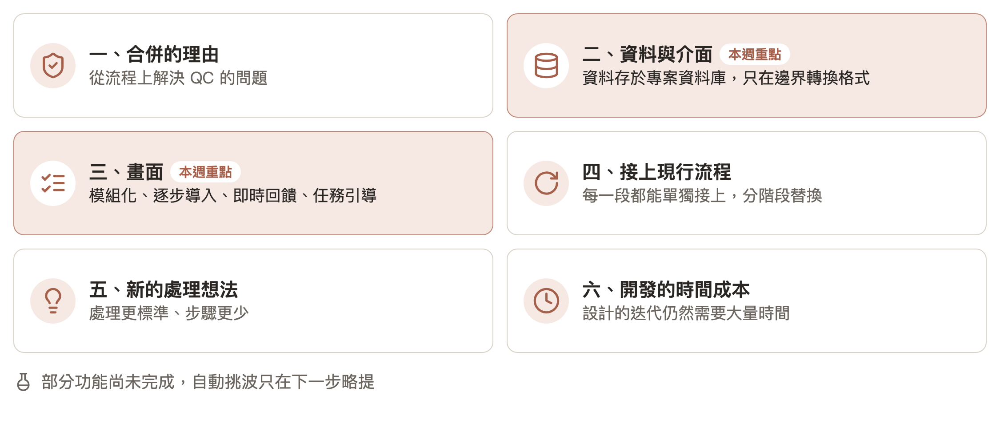

## 一、合併的理由

### 從流程上解決 QC 的問題，減少後面真正需要 QC 的項目

第七週之後，開發者向業務單位展示預檢工具與定位軟體的翻新構想，雙方決定把切事件、挑波與檢查合併成一個系統。

在現行流程中，每一步都讀取上一步寫出的檔案。被 QC 退件時，承辦要回到挑波程式修改，再重新定位。追查一個事件改過什麼，只能比對各階段留下的檔案。合併之後，有四個做法可以減少留到 QC 的問題。

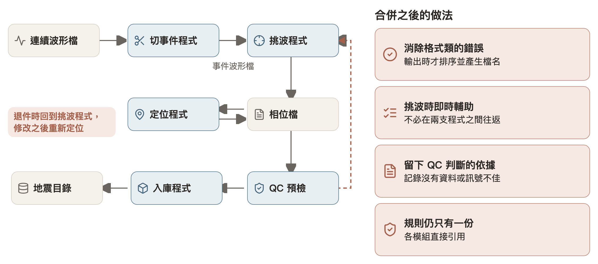

### 格式類的錯誤從根本上消除

事件要依時間排序，但定位到很遠的地震時，發震時間會變早，原本排好的順序因此顛倒。這類錯誤過去要靠 QC 檢查，再退回處理。

問題的來源是檔名與順序在過程中就已決定。現在事件的資料存於資料庫，輸出時才依發震時間排序並產生檔名，這項檢查也就不再需要。

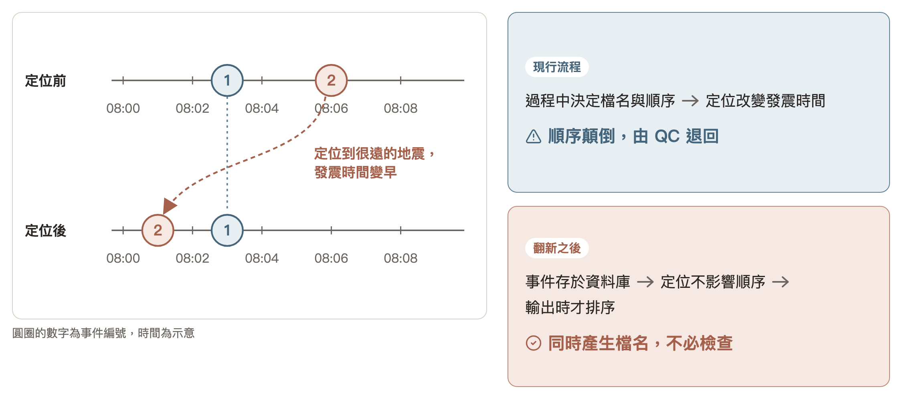

### 挑波時即時輔助

現行流程要挑完、定完、執行檢查程式之後才知道問題，再回到挑波程式修改。現在檢查的結果在挑波當下就看得到，可以當場處理，留到後面的問題因此減少。實際的呈現方式是任務列表，第三部分再詳述。

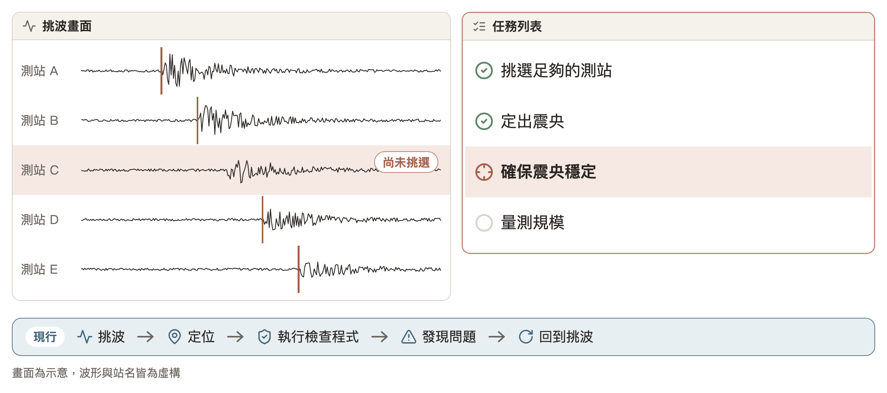

### 留下 QC 判斷的依據

最近的測站沒有挑選，可能是因為沒有資料或訊號不佳。這一點在挑波時從波形就看得出來，但過去沒有地方記錄，QC 只看到這一站沒有挑選，無法區分是遺漏，還是資料本來如此。現在這項資訊可以直接記錄下來。

測站品質篩選也是同樣的想法。依平直、缺漏、雜訊等情況判斷測站的品質，標準無法達到時，至少有個根據。

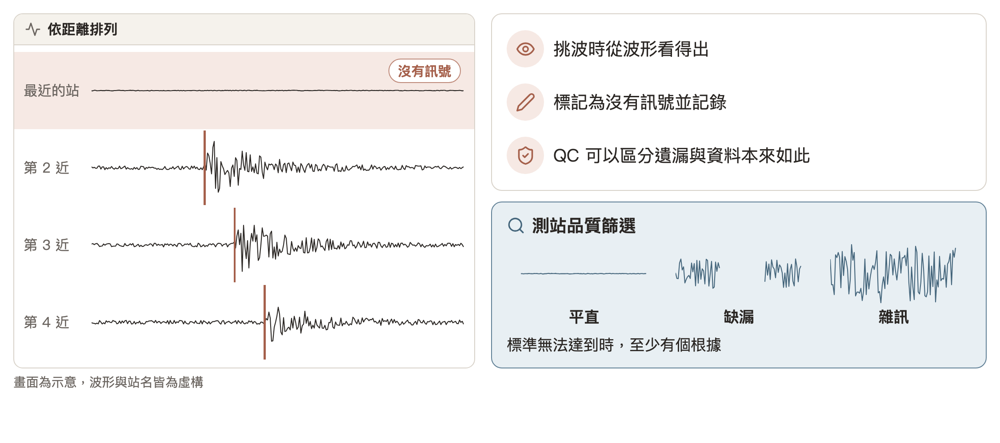

檢查規則仍然只有一份，各模組直接引用，這一點延續第七週「規則只寫在一處」的做法。

## 二、資料與介面

### 檔案格式已經無法應付現在的需求

各程式獨立演化，彼此以檔案交接，因此無法隨意更改格式，也很難加入新的資訊。沿用數十年之後，開始出現無法記錄歷史、精度受到限制等情況。這不代表當初的設計有問題，當時的需求與環境就是如此。真正的困難在於多支程式共同依賴同一種格式，任何一處的改動都會牽動其他程式。

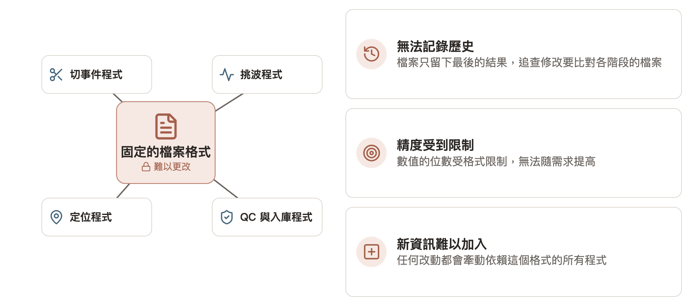

### 資料都存於專案資料庫，只在邊界轉換格式

解決的方式是系統內部不再依賴舊格式，所有資料都存於專案資料庫，舊格式成為對外的一種輸出。

- **檔案格式。** 對接現有系統時才輸出相位檔，做法接近向下相容。未來若要改用更現代、更通用的格式，只需增加一種輸出，不必重新撰寫系統。
- **定位程式。** 介面傳遞定位本身的內容，不再限定相位檔。每一種定位程式各寫一個轉接，日後可以試用較新的定位程式。

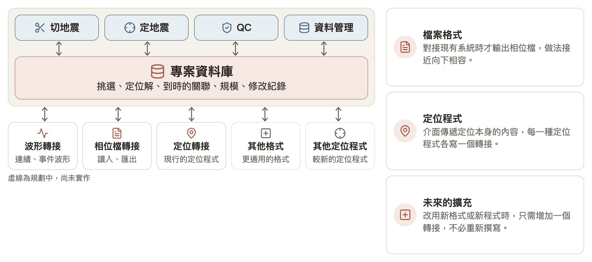

### 資料與處理都在專案內進行，因此可以保留歷史

這個想法來自反射震測處理系統與其他類似的地震分析軟體，這些系統都以專案為中心，資料與處理都在專案內進行。實際的設計如下：

- 資料依 QuakeML 的概念拆成事件、定位解、挑選、到時的關聯與規模。
- 每次定位都保留一版定位解，每一次輸入與輸出都記成一筆工作，因此可以記錄歷史。
- 波形只建索引，原檔留在外部。連續波形檔一天約 43 GB，不複製進資料庫。
- 工作的單位是事件，事件有自己的狀態，進度與交付以工作日計算。

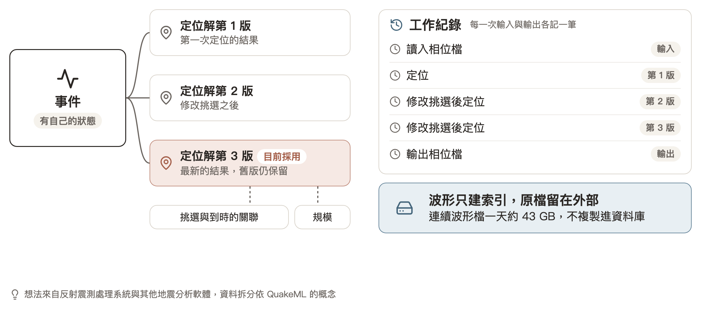

## 三、畫面

### 模組對應原本的步驟，日後容易增加新功能

每個模組對應原本的一個步驟，並以資料庫串接。切地震對應切事件程式，定地震對應挑波與定位程式，QC 對應檢查程式。每個模組是獨立的頁面，單螢幕時為分頁，多螢幕時各放一個螢幕。日後要增加新功能時，只要新增模組並接上同一個資料庫。

模組的切分也經過試做才確定。原本以為需要獨立的波形目錄，試做之後改為切地震的時間軸。試做比討論更快看出結構是否合理。

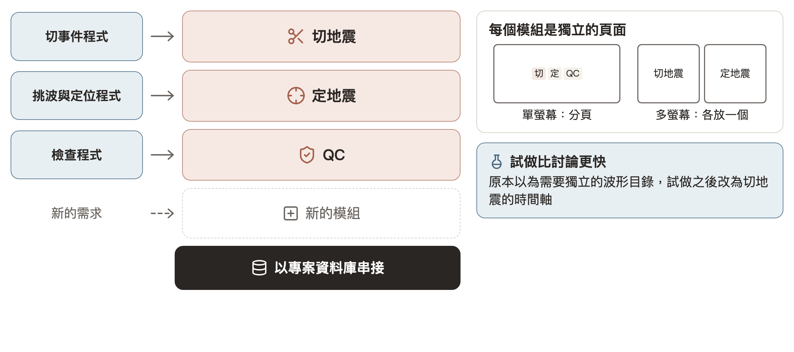

### 導入改變而不干擾使用者

使用者在工作時已有熟悉的操作方式，因此原有的操作先沿用，新功能與新操作由使用者自行選擇，逐步吸收。

#### 原有的功能多半有其目的

原本的功能當初設計出來多半有其目的，這些目的不一定寫在程式碼或文件中。若未沿用，使用者可能找不到原本依賴的資訊，因此重寫之前先向使用者請教用途，尚未確認的先沿用。

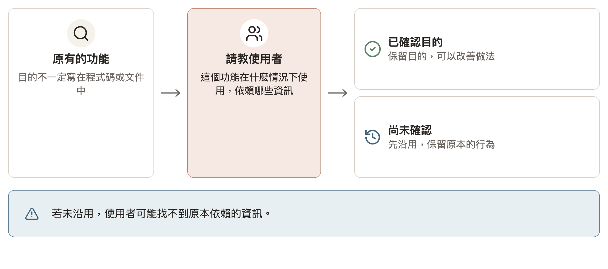

測站分頁是其中一個例子。分頁中的測站依位置排列，不同分頁中位置相近的列，對應的測站在地圖上也相近。切換分頁之後，眼睛停在相同的位置，看到的仍是同一區域的測站。這項設計是請教使用者才得知的。以排序表查證，同一列的兩站距離中位數為 39 至 84 公里，隨機打亂時為 134 至 151 公里。

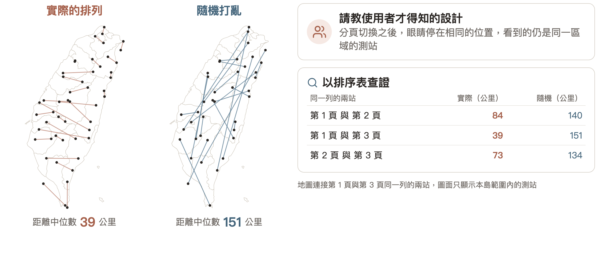

#### 新功能由使用者自行選擇

原本沒有的功能各自設有開關，預設關閉，目前有 14 項。這些實驗性功能一方面可以測試尚未成熟的做法，一方面降低學習門檻，使用者逐項打開，不會因為一次變化太大而不知道如何使用。大家接受並使用一段時間之後，再併入一般功能。

開發者對操作方式的新想法，則放到設定頁作為選項，例如滾輪的用法。這樣開發保有創新的空間，使用者也不會在工作趕時間時受到阻礙。

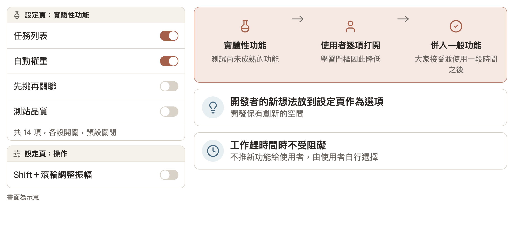

### 所有資訊都即時更新，操作時累積體感

這是介面現代化最大的理由。滑鼠懸停、拖曳或點選時，相關的面板都立即更新。操作的當下就看得到各個數值如何影響最終結果，腦中更容易建立連結。以前的迭代週期要全部跑完，還要自己想辦法畫圖才看得到。回饋的週期縮短之後，才有機會多次嘗試，觀察某一筆到時或權重對定位結果的影響。

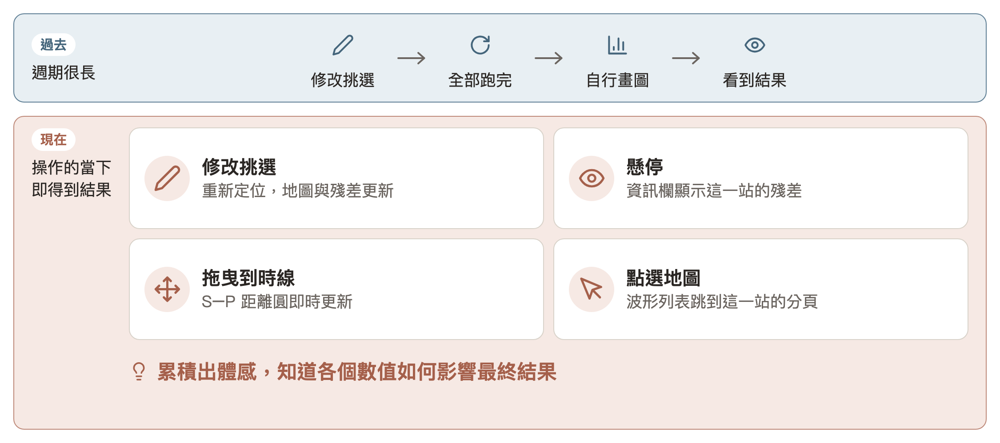

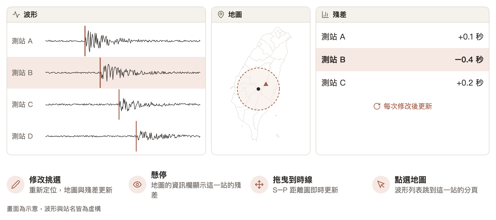

### 任務列表：在旁邊協助檢查的程式

業務單位提到，希望有一個在旁邊協助檢查 QC 的程式，這個形式很接近遊戲的任務列表。主線是定出一個可以交付的地震，依挑波的進度逐步出現下一個目標，支線遇到特殊情況時才出現。任務列表有兩個設計方向，都尚待同仁實際試用確認。

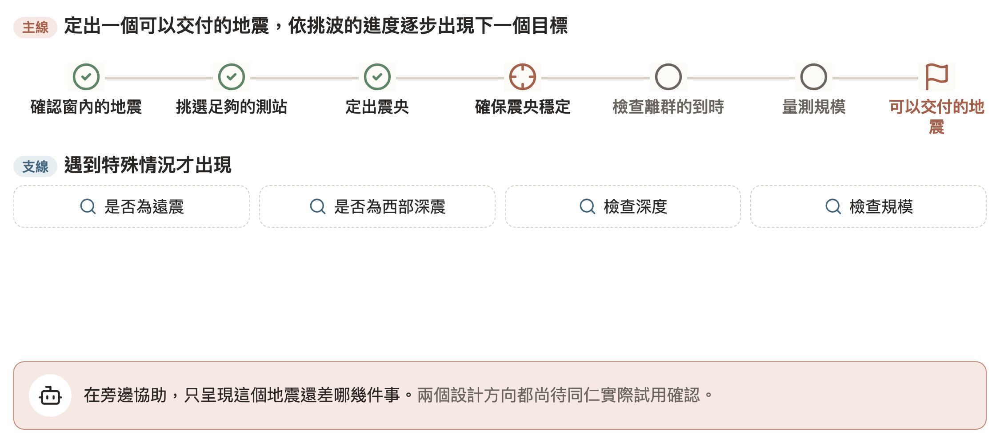

#### 方向一：QC 由批評與阻擋轉為正向引導

同一條規則，由「錯在哪裡」改寫成「還有哪件事要完成」。剛開始挑波時測站數不足是正常的狀態，因此呈現為尚未完成，不列為錯誤。規則本身並未放寬，改變的是呈現的方式與時機。

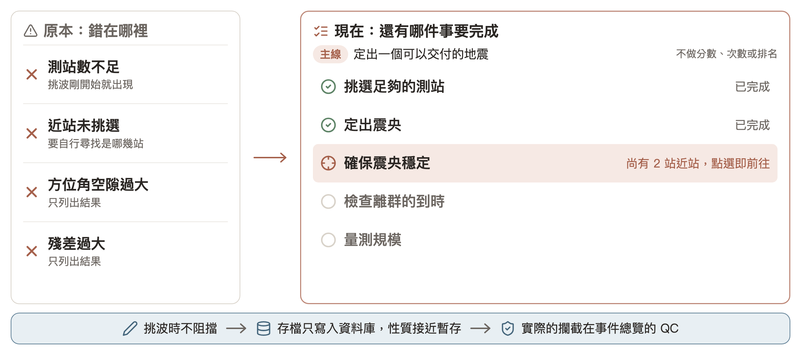

- 選到有任務的測站時，才顯示這一站的任務。點選任務即跳到目標測站，每次定位後即時更新。
- 挑波時不阻擋。存檔只寫入資料庫，性質接近工作階段的暫存，實際的攔截在事件總覽的 QC。
- 只呈現這個地震還差哪幾件事，不做分數、累計次數或排名。殘差類的任務不能靠刪除挑選直接消除，必須寫明原因。

#### 方向二：主動提供這個階段需要的資訊

程式依目前的進度調整介面，不必由人手動切換，使用起來像有一位助手。挑完第一站之後，地圖自動放大到最近幾站的範圍。點開某個任務時，地圖移到那個任務的範圍。

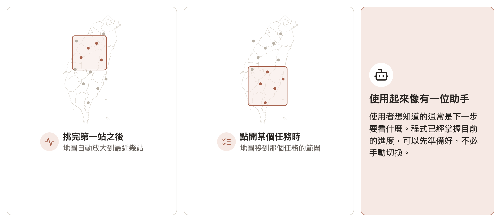

近站任務是一個具體的例子。規則提示近站沒有挑選時，任務列出這些近站，點選後自動跳到目標測站並顯示波形，使用者可以直接判斷要挑選，或記錄為沒有訊號，不必自己尋找近站是哪幾站。

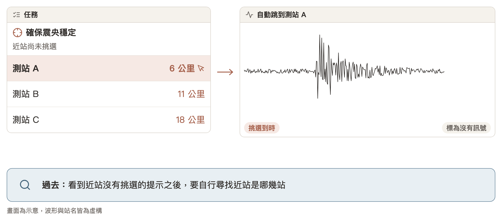

## 四、接上現行流程

### 每一段都能單獨接上現行流程，分階段替換

系統不必一次全換。切地震可以匯出事件波形檔，交給現行的挑波程式。定地震可以匯出相位檔，交給現行的 QC 程式。入庫前則匯出入庫包，交給現行的入庫與發布。

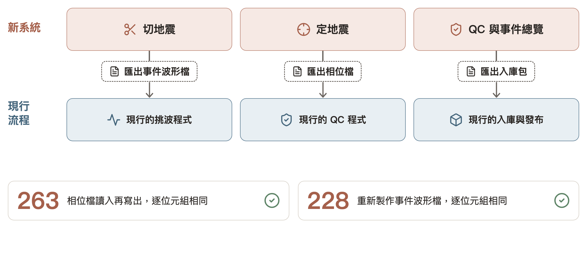

- **新舊產出一致。** 相位檔讀入再寫出，兩天共 263 個檔案逐位元組相同。依原始碼重寫切事件的做法，重新製作 228 個事件波形檔，也全部逐位元組相同。這是第七週特性測試的延續，先證明行為一致，再談改善。
- **入庫仍由承辦完成。** 系統只標到可入庫並產出入庫包，實際的入庫仍由承辦把檔案歸位。
- **持續對照舊程式。** 入庫包匯出時以舊的檢查程式再執行一次，用來找出規則庫的缺口。
- **目前的進度。** 系統已在測試機打包試跑，尚未發布給同仁使用。

## 五、新的處理想法

系統也提供新的做法，讓處理更標準、步驟更少。這些想法都放在實驗性功能，由使用者試用後再決定去留。

### 自動權重：讓處理標準化

教材沒有「多清楚算清楚」的數值，各人的習慣因此有差異。兩天的統計顯示，同仁給的權重與訊噪比關係一致，因此可以由訊噪比算出建議的權重。判斷的規則是不濾波就清楚給 0 或 1，要濾波才清楚給 2，濾波後仍不清楚給 3。目前改用起始分析的訊噪比，門檻與同仁確認之前不視為定案。

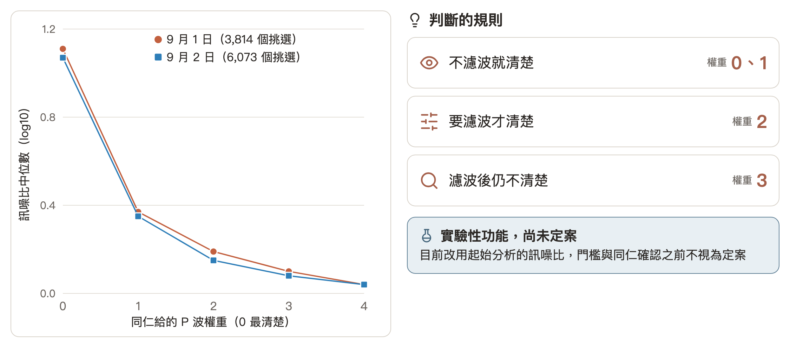

### 先挑再關聯：看到就先挑，再組成地震

原本要先開一個事件才能挑。距離很遠時看到一個地震，不確定是不是同一個，挑了發現不是就要刪掉。已經挑好的挑選其實可以先留著，再判斷是否屬於其他地震。

把同一時間窗的挑選混在一起交給關聯程式，119 個事件找回 108 個。這個數字只說明方向可行，實際操作是否順手，還要由使用者判斷。

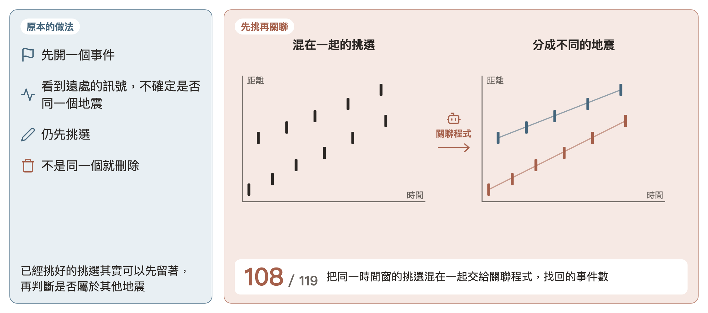

## 六、開發的時間成本

### Agent 降低了撰寫程式的成本，設計的迭代仍然需要大量時間

使用 Agent 開發時，功能做出來並不代表接近完成，因此要預留設計迭代與驗證的時間。過去的時間主要花在規劃資料庫與資料格式、撰寫功能與重構。使用 Agent 之後，實作很快完成，時間轉移到設計與測試驗證之間的反覆迭代。

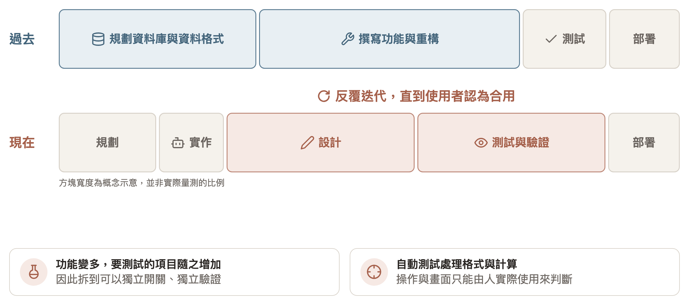

### 功能變多，要驗證的項目也變多

功能做得快就會做更多功能，要測試的項目與一次要考慮的事情也隨之增加，因此要把每個功能拆到可以獨立開關、獨立驗證。自動測試能處理格式與計算。操作是否順手、畫面是否合理，只能由人實際使用來判斷。

10/21 至 11/01 的 app 修改約 268 筆，其中 202 筆只改畫面。筆數不等於時間，只作為參考。

### 畫面要反覆修改，需求也要看到畫面才能確定

標準差截斷是一個小功能，21 分鐘內修改了 7 次，最後拿掉滑桿，改為三個按鈕。波形移到獨立視窗時，功能完成後實際操作才發現點選沒有反應、畫布大小不正確，10 分鐘內修改了 6 次。這些修改都很快完成，真正花時間的是看到畫面之後判斷還缺什麼。

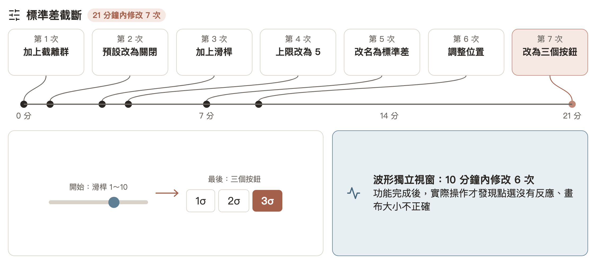

### 短時間做出原型有其前提

這個系統開發至今約兩週。能在短時間內做出原型，是因為有舊程式可以參考，開發者對這個主題也已有研究。沒有舊程式可以對照、也不熟悉主題時，光是確認要做什麼就需要更多時間，因此這個數字不宜直接套用到其他專案。目前還有很多流程上的細節需要細修與迭代，要做到完整並交給使用者測試，過程還會很長。

### 軟體反映組織的流程，兩者會一起演化

軟體反映組織的流程與溝通方式，這個觀察稱為康威定律（Conway's Law，Melvin Conway，1968）。

- **現行系統。** 組織的結構已與當初設計軟體時不同，因此陸續補上許多新的模組，這些修補反映出組織實際運作的樣子。
- **新系統。** 一開始的設計，實際使用時可能與原本的運作方式產生摩擦，要經由迭代才能符合實際情況，這就是花時間的地方。
- **周邊調整。** 組織的分工可能轉變，例如給一個人一個時間段，從頭處理到尾。基礎設施也可能改變，例如要頻繁讀取連續波形檔時，存放與讀取的方式就要重新調整。

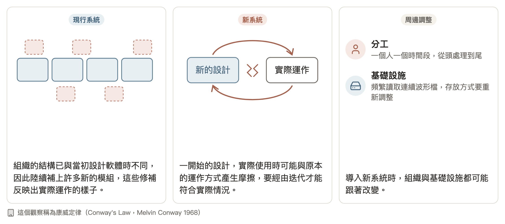

## 下一步的方向

- **實際試用。** 最具體的下一步是讓一些人實際使用，並重新思考要評估的指標，以便記錄成效。
- **互動式教學。** 選出幾個案例，在系統上以引導的方式教導操作，可以沿用任務列表的形式，降低培養新人的門檻。日後也可以作為學校的教具，引發大家對地震領域的興趣。
- **自動挑波。** 以機器學習模型自動挑波並關聯成粗略的事件，作為切事件的參考，結果仍由人確認。內部已有部分在進行。

物理方法的檢查與機器學習保持獨立，例如起始分析與測站品質，日後可以用來攔截自動挑波的錯誤。

## Agent 帶來的改變

### 一個人能跨越的範圍變大，軟體的邊界因此可以改變

過去切事件、挑波、定位與 QC 各自成為獨立的程式，推測與當時的分工有關，這一點尚未查證當時的紀錄。現在一個懂領域的人配上 Agent，可以同時處理資料庫、定位、畫面與規則，合併成一個系統才變得可行。代價是系統集中依賴少數人，這個人離開之後由誰接手，值得一起討論。

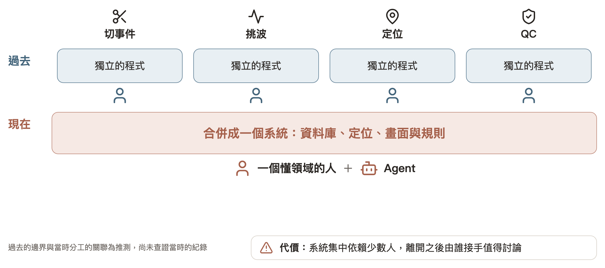

### 設計意圖可以低成本地保存下來

舊程式的設計意圖多半留在使用者的記憶裡，要靠訪談才問得出來。翻新時，提出的人與理由隨著開發一併記下，說明文件約有 150 處。記錄成為開發的副產品，日後不必再靠訪談推測原因。

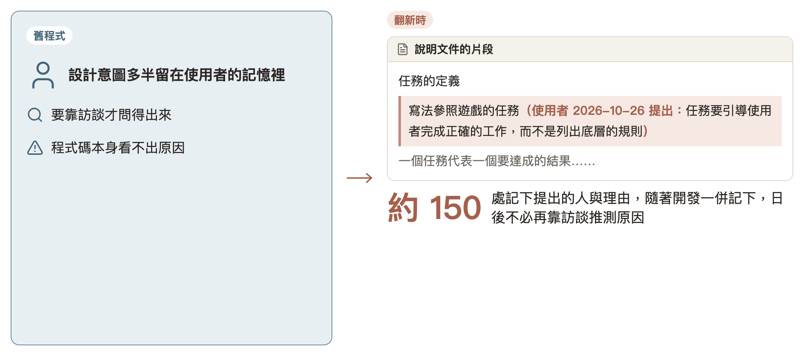

### 新的交付模式（構想）

業務單位現在也可以使用 Agent。請開發者來修常要等上好幾天，遇到緊急又不大的問題，自己修會更快。開發者建立整個流程之後，小幅的修改可以由業務單位透過設計好的 Agent 流程自行完成，概念接近駐點工程師。

這只是多一個選擇。想請開發者修改時仍然可以找開發者，大的功能與重新設計也由開發者處理。這需要明確的修改範圍、測試基準與設計紀錄，才能判斷改動是否安全。

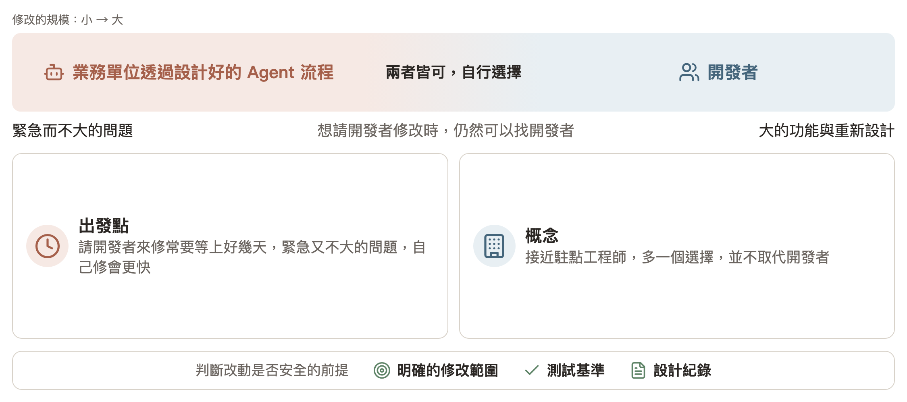

## 討論與交換意見

講述時可以隨時討論，之後的時間留給學員提出題目，逐一討論。可以對照自己的工作思考以下問題：

- 自己的業務中，哪一個沿用多年的檔案格式已不敷使用，卻因為多支程式依賴而難以更改？
- 有沒有相鄰領域的成熟做法可以參考？
- 手上的工具有哪些功能的用途沒有寫下，只有使用者知道？
- 交給 Agent 之後，哪些成果只有自己實際使用才能驗證？
- 一個人能跨越的範圍變大之後，系統由誰接手、如何交接？哪些修改適合由業務單位透過 Agent 自行完成？
