## 從翻新設計到自動挑波

第八週說明了定位工作的翻新設計，當時把自動挑波列為下一步。本週實際做出自動挑波的第一段，也把模型的更新與退回做成可以操作的流程。本週的課程以這段開發過程作為示範，學員不實際操作。

全文分為三個部分，各自回答一個問題：

1. **工具配合人。** 同仁的操作時間很短，又有既定的交接方式，工具如何配合。
2. **模型的更新可以信任。** 模型會持續更新，如何確保每次更新都有依據、可以退回。
3. **重新評估。** 加快每個事件的處理，是否解決了業務真正的問題。

第三個問題在開發的後半才出現。與同仁討論實際的工作量之後，發現原本的目標需要調整，最後一個部分因此回頭檢視前兩個部分的成果。

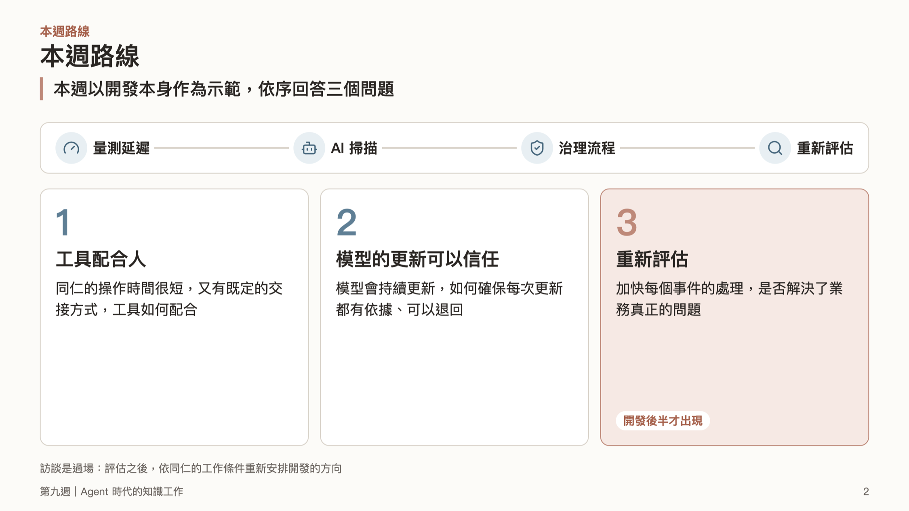

### 先了解同仁的工作條件

開發端容易依技術上的可能性安排工作，但工具是否合用，取決於同仁實際的工作條件。本週因此先向負責定位的同仁請教，得到幾項先前不清楚的條件：

- 每人每天要處理的地震數量不少，每個測站只能花很短的時間，放大、換站與挑選都必須幾乎沒有延遲。
- 切事件與定位由不同的同仁負責，以檔案交接。
- 即時系統原本就有自動結果，但要在事件波形檔產生一段時間之後才補上，切事件時無法使用。
- 定位時多以這份自動結果為底，確認是地震之後逐站快速瀏覽，只在有問題的測站修正。每個事件使用哪一個速度模型定位，也要另外手動填寫。

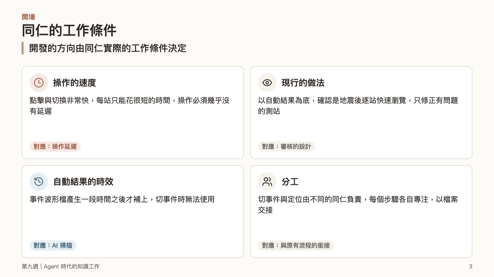

## 一、工具配合人

### 操作延遲

每個測站可用的時間很短，介面上任何等待都會累積成可觀的時間。問題在於不知道延遲出現在哪裡，也不知道哪些延遲可以由程式改善。因此先量測，再改善。量測的目的有兩個：找出應該優先改善的操作，以及劃出程式改善的界線。界線以外的部分，需要改變架構才能解決。

量測分成三種數字，彼此不能混用：程式本身的計算時間、按鍵到畫面更新的時間，以及連續操作時是否掉幀。情境也分成切事件、定位大地震與定位小地震三種。量測與改善的結論有三項：

- **等待最久的操作改善最多。** 切事件時縮小時間軸，由數秒降到數十毫秒。第一次開啟三分量視窗，由約兩秒降到約兩百毫秒。
- **已經預讀的資料幾乎不必等待。** 畫面上的波形讀完之後，系統在背景讀入下一個檔，切換過去只需十餘毫秒。
- **沒讀過的檔無法由程式改善。** 一個連續波形檔超過 100 MB，由網路磁碟讀取就要一秒以上，程式只能提早讀取，無法省略。

第三項劃出了程式改善的界線，下一步的方向因此改為調整架構：交班前先由伺服器算好波形的摘要，輪班時只傳送摘要。這些數字是在開發端與 Windows 測試機上量得的，署內的網路磁碟與多人同時使用的情況，仍需要另外驗證。

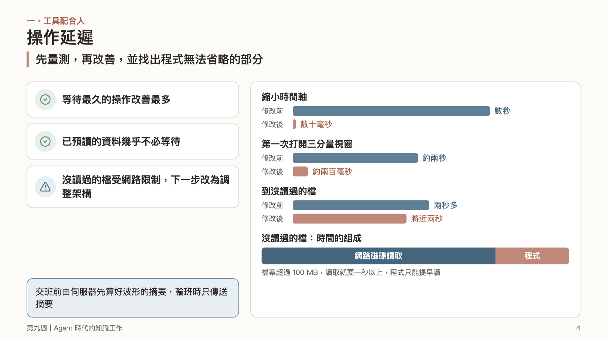

### 自動挑波的流水線

即時系統的自動結果在事件波形檔產生之後才補上，切事件的同仁因此只能以肉眼瀏覽整天的連續波形，定位的同仁也要從空白開始挑波。設計的方向是把自動挑波提前到連續波形的階段，由系統在背景先掃描。同仁的工作由從頭產出改為審核系統的候選結果，系統沒有找到的地震，仍照原本的方式補上。

流程分成三段，本週完成第一段：

1. **AI 掃描（已完成）。** 系統在背景逐檔挑波，定時關聯並定位。
2. **切事件審核（待做）。** 切事件的同仁接受、調整頭尾或刪除候選事件，漏掉的照舊補切。
3. **定位補齊（待做）。** 定位的同仁帶入自動挑選並先定位，再逐站確認與微調，補挑沒有挑到的測站。

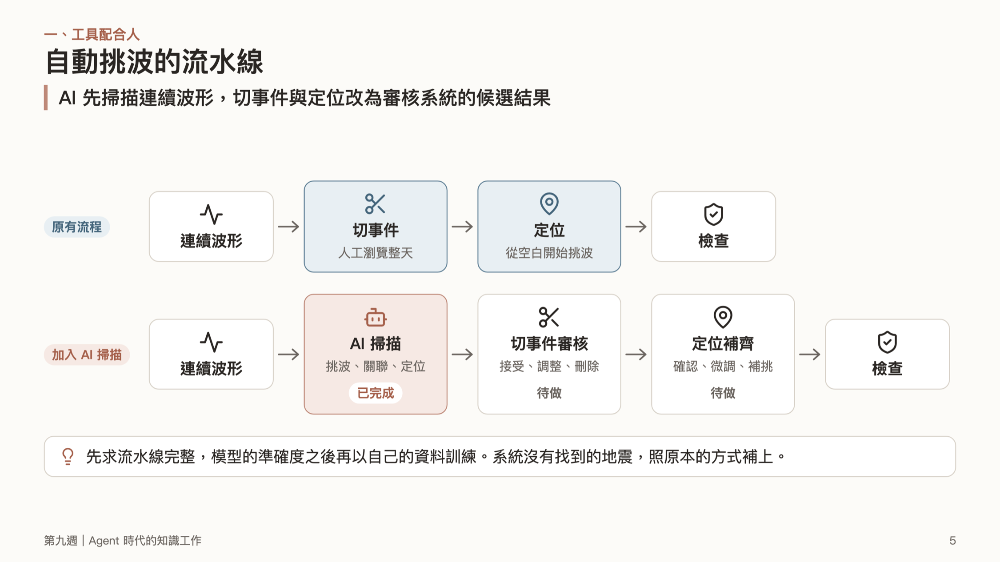

AI 掃描由三個步驟組成，各自使用現成的工具。**挑波**在每個測站的波形上找出 P 波與 S 波的到時，使用開源的 PhaseNet。**關聯**判斷不同測站的到時中，哪些屬於同一個地震，使用開源的 PyOcto。**定位**以同一個地震的到時求出震源，使用現行的定位程式。

#### 關聯的範圍由實驗決定

關聯需要決定一次處理多長的時間。連續波形檔每 4 分鐘一個，最直接的做法是每挑完一個檔就關聯一次，第一版也是這樣做的。結果候選事件遠多於人工結果，多出的大多只由少數測站組成，深度落在搜尋範圍的上下限，屬於把各站的雜訊湊成的假事件。同仁如果要逐一刪除這些候選，審核的工作量會超過原本的做法。

接著做了一個實驗：挑波的結果完全不變，只改變一次關聯的時間長度，比較 4 分鐘、15 分鐘、1 小時與整個班次四種範圍。找到的真實事件在四種範圍下幾乎不變，假事件則在 15 分鐘以上大幅減少，再拉長也沒有明顯的差別。範圍愈長，候選事件出現得愈晚，因此取結果穩定的最短範圍。16 分鐘剛好是 4 個檔，一天分成 90 段。

關聯的工具為什麼在短的範圍內容易產生假事件，原因尚未追查。這個值是由實驗決定的，更換權重或關聯的工具之後需要重新檢驗。

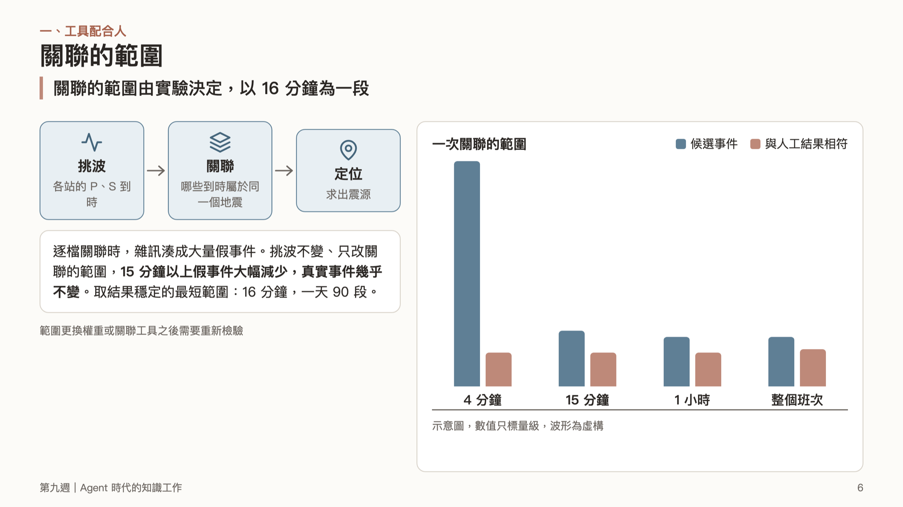

以 16 分鐘關聯之後，約一半的人工事件有對應的候選事件，震央差約在十公里上下。一個檔的挑波只要數秒，掃描的速度足以跟上資料產生的速度。這條流水線完成之後，同仁仍然逐筆審核每一個事件，每個事件處理得更快，但工作的結構尚未改變。第三部分會回到這一點。

### AI 掃描的畫面

畫面的設計意圖是讓同仁可以檢查模型的判斷，不必直接相信結果。AI 掃描獨立成一個模組，排在切事件之前，版面與其他模組一致，波形在左，清單在右。

- **波形牆**涵蓋整天，可以直接拖動。要檢查模型，必須能看到模型沒有標出事件的時段，因此候選事件只是畫在波形上的標記。
- **走時曲線**：測站依緯度排列時，一個地震的到時在畫面上連成一條曲線，是否為地震可以直接由形狀判斷。候選事件的理論走時畫成平滑的雙曲線，與挑選的短線容易區分。
- **單站預覽**放大顯示滑鼠所在測站的三個分量，最下面一列是模型輸出的機率曲線。
- **參數面板**上的前處理與門檻，先作用在預覽的機率曲線上，確認後才以新參數重掃。
- **評估視窗**與人工結果比較，依規模、位置等分項列出偵測率。例如外海事件的偵測率明顯偏低，由於外海的事件本來就少，整體的偵測率幾乎不受影響，這是整體數字看不出來的。

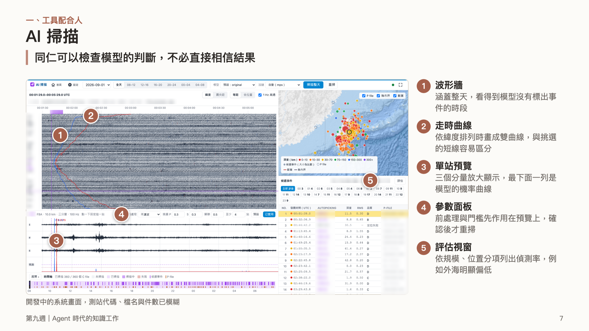

### 與原有流程的銜接

新工具只取代流程中的一段，前後仍然連接原有的程式、檔案與交接方式。新工具如果要求同仁改變交接的方式，或在環境不如預期時無法使用，導入就會受阻。因此新工具負責產出原有流程需要的檔案，同仁不必多做一道手續。

原有的切事件程式除了事件波形檔之外，還會留下兩種紀錄：每個連續波形檔的瀏覽紀錄檔，以及每日的時間窗清單，後續的流程與交接都依賴這兩種檔案。本週的做法如下：

- 看過的連續波形檔各寫一份瀏覽紀錄檔，每天的時間窗累積成一份清單。看過、切下、修改或刪除時間窗之後，由系統自動重寫，同仁不必另外輸出。寫法依原有程式的原始碼，確保後續的流程可以直接使用。
- 畫面看到最後一個檔時顯示等待，新的檔案出現時自動接上，跨日也會接到隔天的資料夾，中間缺檔時提示缺了幾個。
- 輸出一律寫在專案自己的資料夾，不寫回存放原始資料的網路磁碟。設定上也禁止把輸出資料夾指向網路磁碟，以免影響正式的資料。

工作台交付同仁重新安裝之後，一天之內依回饋發布了數個修正版本，修正的項目大多來自署內環境與開發端的差異。例如資料夾改為一律由同仁選擇，網路磁碟連不上時照常啟動，以及只讀取建立專案時選擇的資料夾，開啟的速度因此加快。其中一個版本因為自動測試沒有通過而沒有發布，修正後才以下一個版本送出。程式本身的發布也有關卡，這與第二部分談的模型治理是同一個原則。

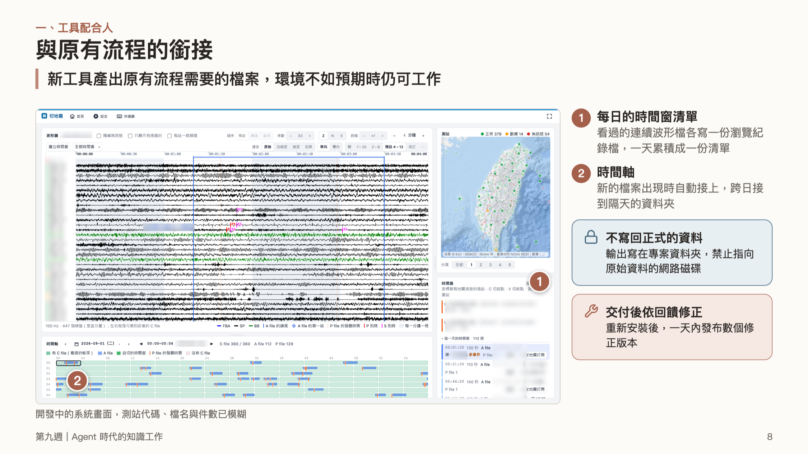

## 二、模型的更新可以信任

### 治理流程

模型會持續更新，每次更新都可能在某些情境進步、在另一些情境退步。如果沒有固定的流程，更換模型之後出了問題，既無法得知是哪一版造成的，也無法退回。

因此在追求模型的表現之前，先把更新的流程做出來。做法是拿一組已經訓練好的權重走完全程，不要求它的表現，每一段先以最簡單的方式完成。流程先存在，問題才會在試跑時出現，不必等到上線之後才發現。每一步的設計都對應一個具體的風險：

1. **匯出。** 訓練端為權重補上雜湊值與模型說明書，沒有補的權重在入倉時會被擋下，防止來源不明或內容被更動的權重進入系統。
2. **入倉。** 選擇模型包時，先顯示說明書與檢查的結果，確認後才收入模型倉，防止未經檢視就開始使用。開源的權重也一併收入，作為比較的基準。
3. **掃描。** 以新權重掃描同一段資料，每筆結果都記下權重的版本與雜湊值，防止事後無法得知結果由哪一版產生。
4. **比較。** 新舊版本並列，只計兩者都掃過的檔，產出比較報告，防止以不同的資料比較而得到不公平的結論。
5. **換版與退版。** 依比較報告把新版本設為預設，出問題時退回舊版，兩者都要填寫理由，防止換版沒有依據。

每一次操作都留下紀錄，只增不改。入倉、比較與換版都由人觸發，不做自動排程。

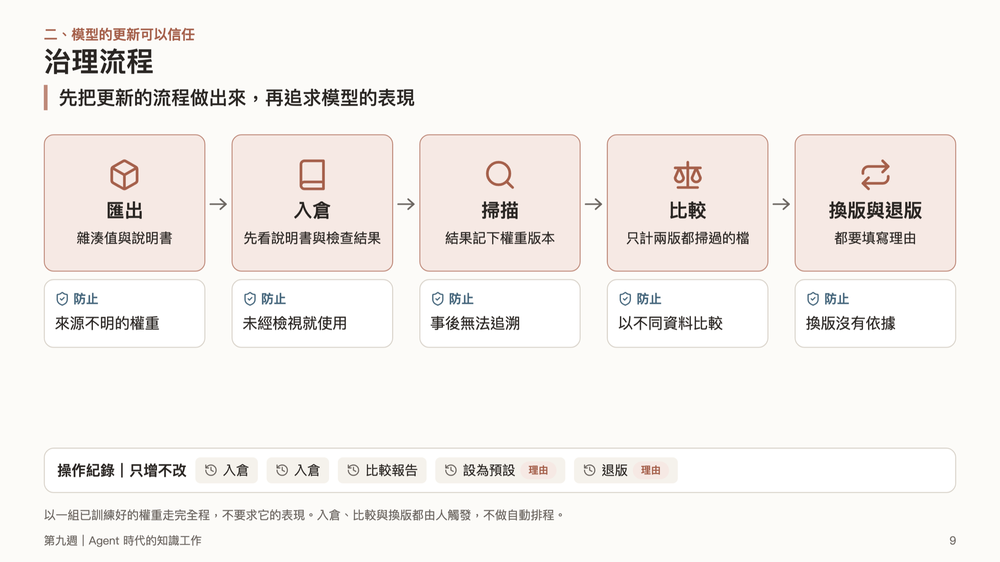

### 持續訓練

模型日後要以新累積的資料持續訓練。這裡有一個技術上的問題：訓練後期學習率會降到接近零，直接加入新資料，模型幾乎不再更新，把學習率調回原值又會大幅偏離原本的狀態。因此每一輪重新安排學習率，先短暫升高再衰減，並混入一半的舊資料，避免模型遺忘。

第一輪試跑以前一年的權重加入下一年的資料，訓練只花了幾分鐘。新舊兩份測試集都比上一版好，通過關卡。但是放進工作台掃描同一天的資料，事件的偵測率反而大幅下降。原因是微調之後機率的峰值變低，挑選的門檻隨權重調低，關聯的門檻卻沒有跟著改。

這次試跑說明兩件事。第一，關聯的門檻也要隨權重一起交付。第二，離線測試集通過關卡，不代表在實際資料上比較好，換版仍要以比較報告為準。這個問題在試跑時就出現，沒有等到上線之後才發現，這是先把流程做出來的用處。

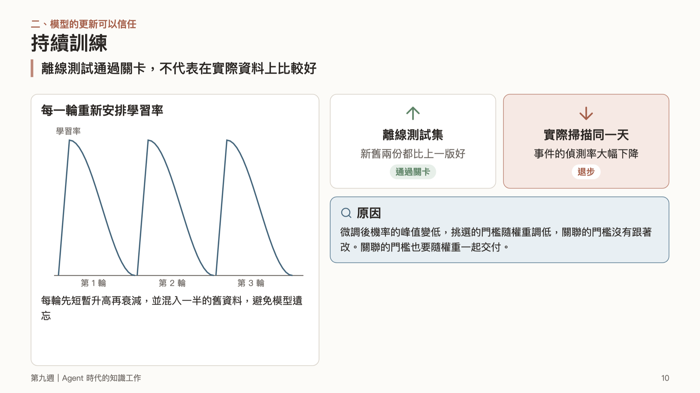

### 交付到署內的電腦

同仁使用 Windows，自動挑波最後要能在署內的電腦上執行。深度學習的執行環境體積很大，而且不是每一台電腦都需要自動挑波，因此主程式、自動挑波的環境與模型分成三份交付，各自可以單獨更新。

- 主程式與自動挑波分開打包，不使用自動挑波的電腦，不必安裝較大的環境。
- 推論改用 ONNX 格式，環境包不需要帶入深度學習框架，體積因此縮小。
- 模型以模型包交付，在設定頁選擇模型包入倉。模型進入署內電腦的入口只有這一個，與治理流程使用同一個模型倉，不另開一條路徑。

打包時修正了數個只在 Windows 出現的問題，例如中文資料夾的路徑與預設的文字編碼，都是在 Windows 測試機上實際執行才發現。

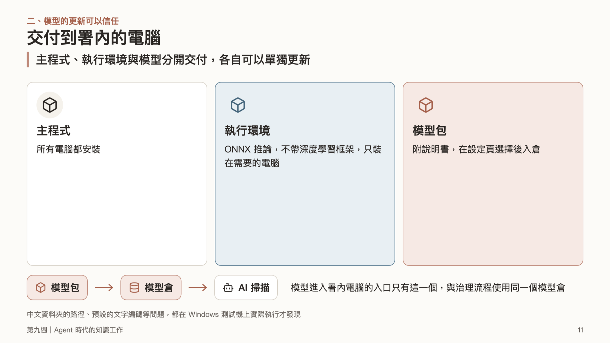

### 制度的依據

流程做出來之後，導入還需要回答技術以外的問題。這裡不自行發明一套制度，而是以公部門既有的手冊與法規檢查導入的規劃，整理成提案書。提案書儘量同時符合台灣常見的標準，日後不需要大幅修改，開發時也可以作為提醒。參考的資料包括數位發展部《公部門人工智慧應用參考手冊》、iPAS AI 應用規劃師中級學習指引、人工智慧基本法，以及資通安全的相關規定與 ISO/IEC 42001。Agent 讀取這些原文並整理成可以對照的形式，再由人挑選適用的部分。

對照之後，目前有三項具體的結果：

- **管理制度至少要回答五件事。** 依手冊的要求，分別是誰是使用者、系統的目標、有哪些利害關係人、如何檢查使用紀錄，以及誰有監督與糾正錯誤的權限。
- **模型的提供者不能自行換版。** 新版本設為預設之前，須經核准者同意。
- **審核紀錄不用於考核。** 同仁審核與修改的紀錄只用於模型的評估與訓練，個人的統計不列入效益報告。

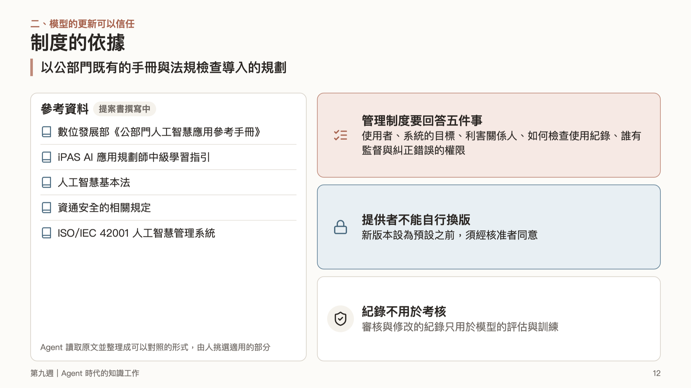

### 比較的基準

流程走通之後，接著要決定與什麼比較才算數。換版時如果可以自由選擇資料與指標，很容易不自覺地挑選對新版本有利的組合。因此基準要在看到結果之前決定並固定，日後更改也要經過核准並留下紀錄。這一點屬於治理，技術無法代為決定。

目前的比較對象是開源權重，正確答案是人工相位檔，測試資料只有某一天的一個班次。這足以打通流程，但不足以作為換版的依據。基準可以分成以下幾件事討論。

**比較的對象。** 不同的對象回答不同的問題，可以並用。與開源權重比較，回答自行訓練的模型是否勝過免費就能取得的模型。與即時系統現有的自動結果比較，回答新做法是否勝過署內已在使用的結果。與上一個正式版本比較，回答這次更新是否退步。與不同同仁之間的差異比較，回答模型與人的差距是否已經小於人與人的差距。最後一項決定是否還值得繼續提高準確率，差距如果已經更小，重點就應轉向省工與分流。

**測試資料。** 測試的事件不得出現在訓練資料中。固定的測試集加上版本，使不同時期的結果可以比較，再以滾動的近期資料反映測站網的變動。外海、深源、小規模、密集餘震與雜訊期間都要涵蓋，並分項計分。

**計分方式。** 前處理與各項門檻隨權重一起固定，比較的是整條流程，持續訓練的第一輪已說明這一點。容許的誤差依實際用途訂定，例如差多少以內同仁就不必修改。門檻在開發資料上選定，測試資料只用來評分。

**找出困難的資料。** 選擇測試資料之前，要先知道哪些資料本身就難以判斷。本週另外以三個模型挑同一批標記資料，依結果把每筆標記分成各模型一致、意見分歧、都挑在別處與都沒有挑到幾類。各模型都挑在別處或都沒有挑到的標記，問題可能出在標記本身，而不在模型。各模型一致的資料，比較適合作為測試的基準。自行訓練的模型以同一份標記訓練，不能當作獨立的裁判，多模型比對只用來找出需要人檢查的資料，標記的對錯仍由人判斷。

**正確答案。** 這是最困難的一項。目前以人工的相位檔作為答案，但人工結果是否適合作為答案，取決於它是在什麼條件下產生的。第三部分先說明這個問題的來源，再回到正確答案的選擇。

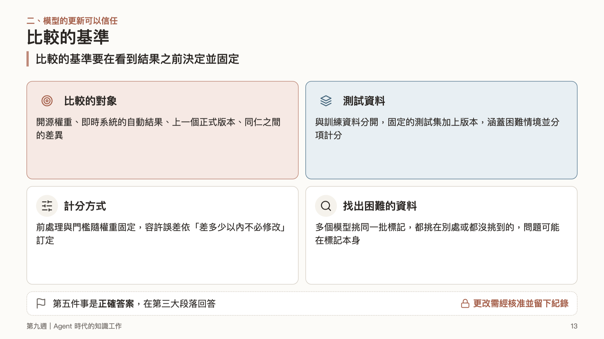

## 三、重新評估

前兩個部分都假設目標是讓每個事件處理得更快。與同仁討論實際的工作量之後，需要回頭確認這個目標是否正確。這一部分先回到業務的目標，再以這個目標檢視做出來的成果，暫時不考慮技術上已經投入多少。

### 件數壓力下的補齊

每天要處理的地震數量多，每個地震可用的時間有限，檢查時又以測站數量作為品質的條件之一。在這樣的條件下，參考理論到時補上波相不清楚的測站，很容易成為完成工作的方式，其中可能混入實際上沒有相位的雜訊。

教材本身已有提醒，理論值只作為參考，不清楚的到時權重不要給太重。這裡要討論的是流程與指標如何設計，讓這些提醒容易做到。參考理論值補上的到時有三個影響：

- 補上的到時貼近理論值，殘差偏小，定位品質看起來比實際好。
- 這類到時進入訓練模型用的標記。以空間一致性檢查標記時，它們反而看起來最正常。
- AI 導入之後補齊會更快，問題可能更嚴重。

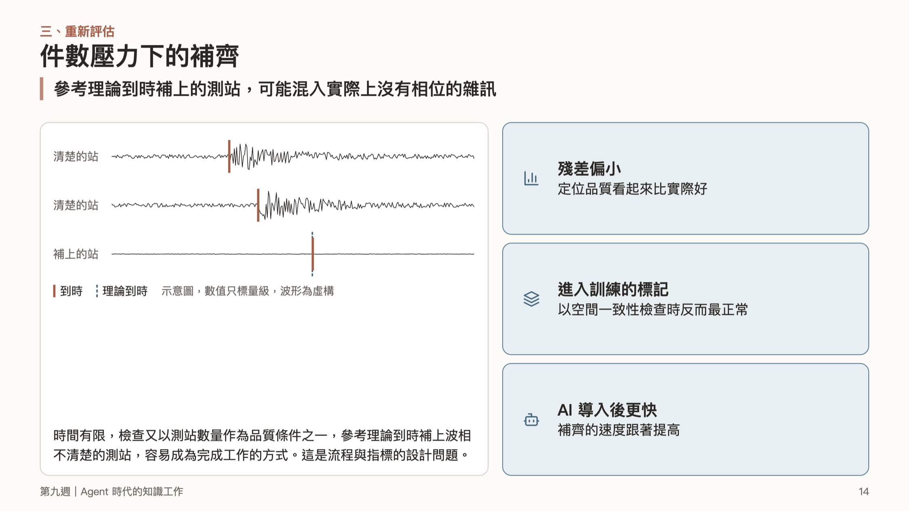

### 導入 AI 是否解決了問題

進一步討論後確認，最大的業務目標是補齊落後的月份。以這個目標檢視本週做出來的流水線：AI 先挑波，同仁審核並補齊，最後仍然逐筆產出相位檔。這個做法縮短了每個事件的處理時間，但工作的結構沒有改變：

- 人力仍與事件數成正比，落後的月份只是補得比較快。
- 檢查的條件仍以測站數量為主，補齊的誘因依然存在。AI 讓補齊更容易，問題可能反而擴大。
- 交付的成果仍是每個事件都經人工挑選，品質卻無從得知。

因此，只把 AI 放進現有的流程，解決的是速度，沒有解決品質與落後的根本原因。要解決這兩項，需要重新思考人的角色、效益的衡量方式，以及交付的成果。

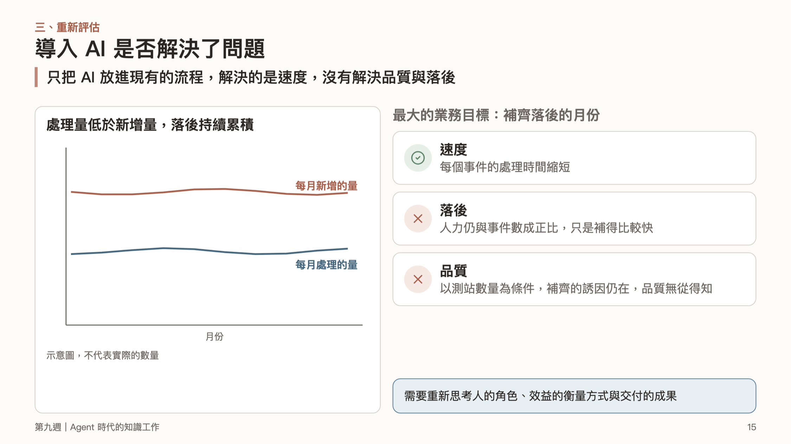

### 品質先於數量

人力要與事件數脫鉤，人就必須由逐筆審核改為監督。方向是把品質放在數量之前，人只處理困難或不確定的部分。

大地震與有感地震以現有的自動化已可大致完成。數量最多、需要補齊的是小地震，而小地震本身有研究價值。研究需要的是完整度、時間上的一致性與測站間精確的相對到時，不要求每一筆都經人挑選。分流依三個問題進行：

1. **是不是地震。** 多站的到時是否一致。
2. **附近有沒有已確認的地震。** 同一處的地震波形相似，可以拿已確認的事件當樣板，推得到時。
3. **定位的約束夠不夠。** 測站不足時不補站，照實記錄位置與不確定度。

依這三個問題，事件分成四類。與已確認事件相似的，由樣板推得到時，自動定位後抽查。一般的小地震、清楚的測站足夠的，自動接受後抽查。確定是地震但測站太少的，保留事件與不確定度，列為暫定。存疑的事件才由人工審核。

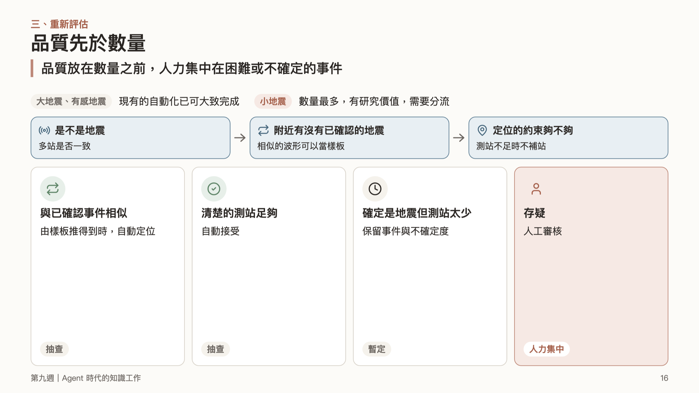

### 效益的呈現

原本規劃以同仁需要修正的筆數與處理時間作為主要的效益指標。這個指標仍假設每個事件都由人審核，重新評估之後，只用來比較不同版本的權重。準確率也不適合作為主要依據，因為它以人工結果作為正確答案，人工結果又可能含有補上的到時，數字的高低因此難以解讀。

這裡改問另一個問題：在固定的品質關卡下，有多少事件不需要人處理。呈現的方式有四種：

- **自動接受的比例。** 先固定抽查錯誤率的上限，再報告通過關卡的事件占多少。模型進步時比例上升，品質維持不變。
- **落後量的增減方向。** 每月的處理量是否超過每月的新增量。
- **品質由未知變為已知。** 現行的成果每筆都經人工，錯誤率卻無從得知。改為抽查之後，每一批資料都有錯誤率的估計。
- **自動化的等級。** 依地震的類別列出目前所在的等級，取代單一的準確率。

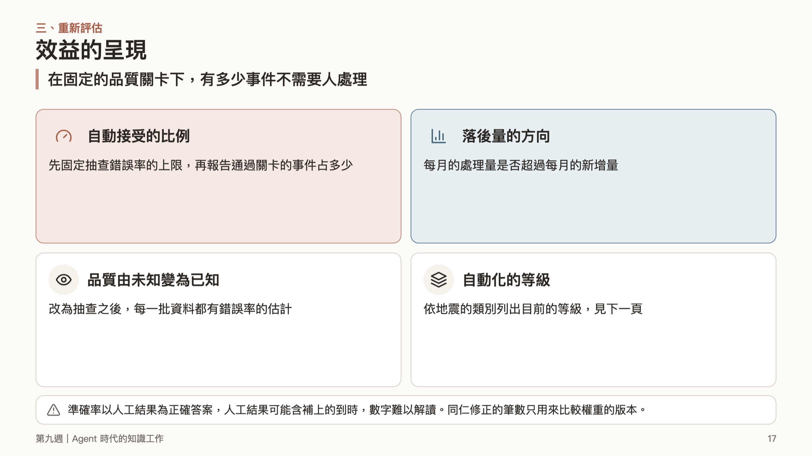

### 自動化的等級

等級分為五級，區別在於人的工作，以及人力是否隨事件數增加：

- **等級 0：逐站挑波。** 人力與事件數成正比。
- **等級 1：帶入自動挑選，逐筆修改。** 仍成正比，每個事件的時間較短。
- **等級 2：逐筆審核。** 仍成正比，每個事件的時間更短。本週的流水線屬於這一級。
- **等級 3：只處理存疑的事件，其餘抽查。** 人力只與存疑事件的比例成正比。
- **等級 4：訂定標準、抽查、整批重跑。** 人力接近固定，不隨事件數增加。

等級 0 到 2 只縮短每個事件的處理時間，屬於量的改變。工作的結構在等級 3 以後才改變，原因有三項：

1. **人力與事件數脫鉤。** 抽樣檢驗的樣本數隨批量成長得很慢。一批資料可以整批接受之後，資料量增加數倍，抽查的工作只增加少許。
2. **處理速度遠超過資料產生的速度。** 掃描一個檔只需數秒，整年的資料因此可以在數天內重新處理。模型更新後整批重跑、產出下一版目錄才成為可行的做法。
3. **結果可以重現。** 同一份資料重跑的結果相同，目錄在時間上一致，才能用於統計研究。

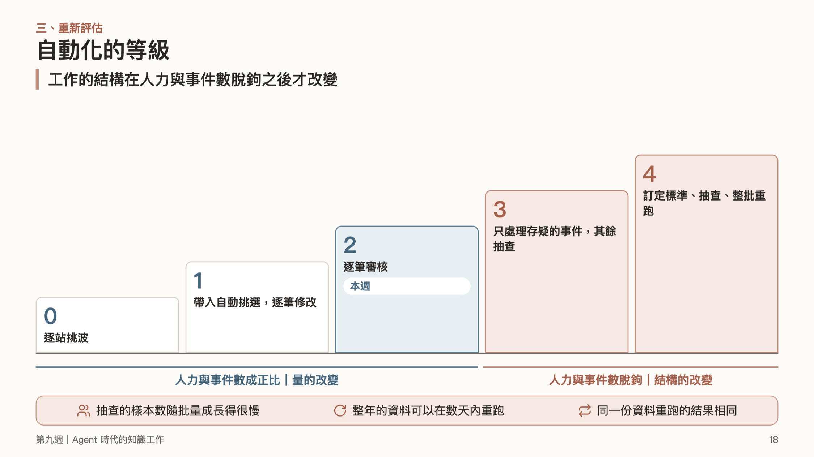

### 監督角色的條件

人要從逐筆審核改為監督，模型需要達到的條件有四項，都與整體的準確率無關：

- **信心能區分對錯。** 錯誤要集中在信心低的部分，使信心高的部分錯誤率低於核定的上限。上限可以參考同仁之間的差異。
- **事件的偵測率要高。** 人只審核候選事件，沒有候選的地震無從補救，因此需要另一個獨立的來源互補，例如即時系統的自動結果或樣板比對。多出的候選事件代價較低，可以由人或後續的檢查排除。
- **自動接受的比例有下限。** 下限由人力與落後量決定，等於 1 減去人力產能除以每月需要處理的量。每月需要處理的量，是新增的量加上預計消化的落後量。這個下限可以計算，不需要等到模型接近完美。
- **失效可以察覺。** 抽查不通過時整批降級重審，測站變動時有監控可以發現。

為了檢查第一項條件是否成立，以某一天整天的連續波形、開源權重與人工結果做了初步的試算。如果模型的信心無法區分對錯，分流與抽查的設計就沒有依據。結論有四項：

- **挑選的信心能區分對錯。** 模型給的機率愈高，到時與人工的差異愈小。機率最高的一組幾乎都與人工一致，機率偏低的一組則有相當比例差異較大。
- **事件的信心也能區分對錯。** 只由少數測站組成的候選事件，多數沒有對應的人工事件。測站數量足夠、且測站包圍震央的候選事件，大多有對應。
- **高信心的候選涵蓋的範圍不大。** 符合上述條件的候選只涵蓋一小部分的人工事件，另有不少人工事件完全沒有候選，集中在測站很少的小地震。監督角色目前的瓶頸在偵測率與涵蓋率，高信心挑選的精度已經足夠。
- **模型失分的地方集中在人工也沒有把握的到時。** 這些到時多數被同仁自己標為品質較低的等級。這個結果不能證明它們是參考理論值補上的，也可能是模型在微弱訊號上表現較差，仍需另外檢驗。

試算只有一天的資料，結果只用來判斷方向。

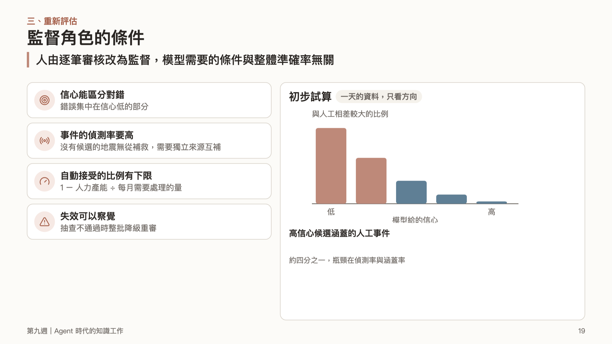

### 正確答案的選擇

比較的基準留下的問題可以在這裡回答。先釐清什麼是可以直接確認的事實：在儀器時間正確的前提下，到時是唯一直接的觀測。震源的位置是到時與速度模型反覆迭代的結果，地震本身也有方向性、不是一個點，因此定位結果本來就帶有不確定度。正確答案因此應以到時為準，而到時的品質要先確認。

以現行的人工結果作為答案，參考理論值補上的到時也會被當成正確，模型不挑雜訊反而算成漏挑。可以考慮的方向有三個：

- 只採用清楚的到時，品質等級低的不列入評分。做法簡單，但會排除最困難的情境。
- 建立少量的精審資料。由資深同仁在沒有件數壓力的情況下，兩人以上獨立審核一小批事件，同時量出同仁之間的差異。這個差異也是監督角色第一項條件需要的上限。
- 以物理方法交叉驗證，但不以另一個模型判斷模型的對錯，以免形成循環。

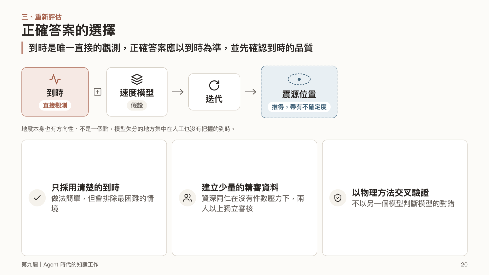

### 跳脫框架的方向

上述的調整改變了人的角色與效益的衡量方式，但交付的成果仍是逐筆的相位檔與單一的目錄。交付的成果與工作的分配是否也需要改變，需要另外討論。這些方向牽涉目錄的定位、正式目錄的認定與人力的安排，都需要署內決定，開發端只列出方向與各自的依據。以下的方向都還沒有評估可行性：

- **地震目錄的再分析。** 氣象領域有再分析資料，以固定的現代系統重新處理歷史觀測，產出前後一致的資料集。地震目錄也可以比照，以同一套自動流程批次處理落後的月份，甚至過去的年份，產出有版本的研究用目錄。模型改進之後整批重跑，產出下一版。落後的月份因此不必逐月追趕，人力轉為驗證與抽查。
- **作業目錄與研究目錄分開。** 作業目錄重視時效，以大地震與有感地震為主，已可大致自動化。研究目錄重視完整與一致，由再分析產出。兩者的品質要求不同，不必用同一套流程與人力處理。
- **小地震不一定需要逐站挑波。** 以已確認的事件為樣板，用波形比對偵測相似的事件，再以測站間的相對到時做相對定位。對許多研究用途而言，這比逐站的絕對到時更精確。
- **人的工作由產出到時改為教導系統。** 同仁的時間用在審核系統最沒有把握的事件、維護樣板與精審資料，以及決定分流與抽查的標準。每一次審核同時成為下一版模型的訓練資料，人的判斷因此累積在系統裡。
- **調整指標，而不只是調整工具。** 以定位的不確定度取代測站數量作為品質條件，以目錄的品質取代每人的件數作為業務指標。補齊的問題主要來自指標，這一項不需要 AI 也能先做。
- **以三維速度模型統一定位。** 目前每個事件要選擇一個速度模型，並手動填寫使用的是哪一個。一律以三維速度模型定位之後，選擇的步驟因此消失，目錄在空間上也更一致，這也是再分析需要的條件。
- **把功夫往前移到測站。** 雜訊多、時間有誤的測站，會在後段造成大量的檢查與修正。測站的健康狀況若能自動監控，後段的工作量也會跟著減少。

開發端的下一步，是以另外幾天的資料模擬分流，計算各類事件的比例與自動接受的錯誤率，作為討論這些方向的依據。

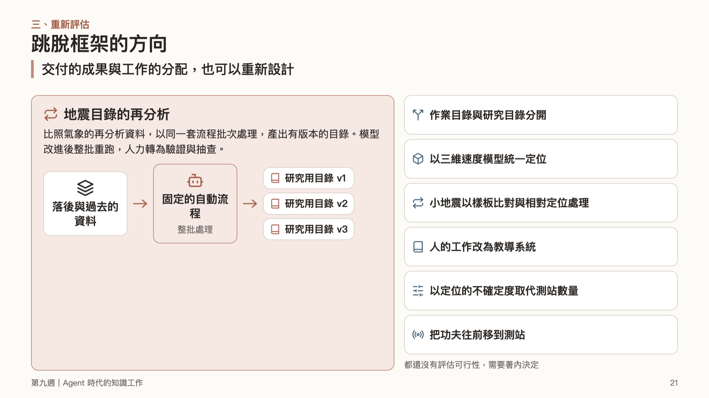

## Agent 在本週分擔的工作

本週做出了自動挑波的第一段與模型的治理流程，也確認加快審核並未解決落後與品質的問題。方向因此調整為品質先於數量，人由逐筆審核改為監督。Agent 在其中分擔的工作包括：

- 撰寫與修改程式，量測延遲並比較修改前後的數字。
- 依同仁的回饋在一天內連續修正並發布，每個版本先通過自動測試。
- 以實驗比較關聯的範圍，並試跑持續訓練。
- 讀取手冊、學習指引與法規的原文，整理成可以對照的形式。
- 以既有的掃描結果與人工結果試算信心與錯誤的關係。

各段的意圖與判斷仍由人提出，例如以 16 分鐘為一段、換版要經過核准，以及把品質放在數量之前。其中最後一項來自與同仁討論實際的工作量，這是程式本身無法提供的資訊。Agent 負責的是把意圖做成可以檢驗的結果。

## 討論與交換意見

講述時可以隨時討論，之後的時間留給學員提出題目，逐一討論。可以對照自己的工作思考以下問題：

- 自己的業務導入新工具時，同仁的哪些工作條件是開發端事先不知道的？
- 手上的工具或模型更新時，如何得知是哪一版造成問題，又如何退回？
- 比較新舊做法時，基準是在看到結果之前還是之後決定的？
- 業務的指標是否在不知不覺中鼓勵了降低品質的做法？
- 導入 AI 之後，工作的結構是否改變，還是只是同樣的工作做得比較快？
